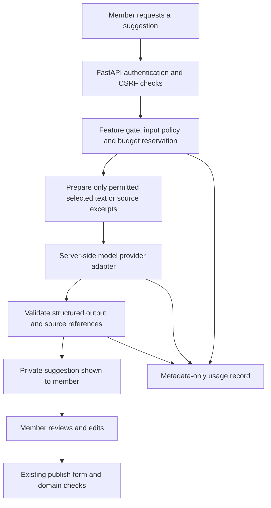

# AI integration review and proposal for Nurse.ng

**Prepared:** 17 November 2026  
**Status:** proposal for our next discussion; no AI feature has been implemented by this review.  
**Purpose:** identify useful AI features for the actual application, explain how they could fit, and preserve the decisions we need to make.

This record follows the current direction in [Community expansion](COMMUNITY_EXPANSION.md): increase adoption and sustained participation across every nursing career stage, beginning in Nigeria. Employer expansion remains a later phase.

The review used the working repository, its current services and product documents. It did not inspect members' private conversations, query their records, send content to an AI provider, or run paid API requests. Provider prices, availability and contractual terms were not checked live; cost figures below are explicitly illustrative.

For a quick joint review, start with [the recommendation](#1-my-recommendation), [the feature comparison](#3-candidate-features-and-delivery-order), [the first pilot](#5-first-pilot-optional-writing-assistance), [costs](#11-cost-model-and-spending-control) and [the decisions to discuss](#15-decisions-for-our-next-discussion). The remaining sections provide examples, integration details and evaluation criteria.

## 1. My recommendation

Begin with an **optional writing helper for introductions and nonclinical community questions**. A member supplies their own text, requests a clearer or shorter version, reviews the suggestion, and decides whether to use it. This fits the existing newcomer and discussion journeys, requires little source infrastructure, and gives us a concrete way to test whether AI helps people participate.

The next candidate is **search and app guidance with source links**: help members find an appropriate community, existing discussion, learning activity or current opportunity. Start with a small approved collection of app instructions and existing search results. Expand only when retrieval quality and source permissions are established.

Keep **AI extraction of difficult recruitment announcements** as a separate staff-facing experiment. It could save review time, but it serves a different immediate outcome and carries higher factual risk. It should extend the existing pipeline rather than replace its source checks.

These recommendations depend on evidence. If members already write comfortably but cannot find useful conversations, the search feature should take priority. If staff spend most of their time deciphering eligible announcements, extraction may produce the clearest operational return. A short baseline assessment should resolve that before development.

### What success would look like

- A newcomer publishes a useful introduction or question with less effort.
- Another member finds a relevant conversation and receives help from real peers.
- Members can understand an opportunity without losing its original evidence.
- Staff spend less time on repetitive interpretation while retaining control of decisions.
- The additional cost and review workload remain manageable.

AI usage alone is not success. The important outcomes are useful participation, answers, connections and returning members.

## 2. What the app already has

AI should add a useful capability to these foundations.

| Existing foundation | Evidence in the repository | Implication for AI |
| --- | --- | --- |
| Public communities, questions, replies, Helpful recognition and selected answers | [Community engagement](COMMUNITY_ENGAGEMENT.md), [community services](../app/services/community.py) | Writing assistance and linked summaries have clear places to appear. A Helpful answer is community feedback, not proof of clinical correctness. |
| Optional newcomer goals, introductions and host welcomes | [Participation guide](COMMUNITY_PARTICIPATION.md), [participation services](../app/services/community_participation.py) | Help a newcomer express a goal or introduction; keep the host's actual welcome and the member's publication decision. |
| Community, people and opportunity suggestions | [Member discovery](../app/services/member_discovery.py), [community suggestions](../app/services/community_growth.py) | Explainable matching by interests and location already exists. Better filters or search may solve the problem without a model. |
| Voluntary peer support and private support requests | [Mentorship services](../app/services/mentorship.py) | An optional goal-writing helper or explanation of a public support offer could help. Acceptance, capacity and connection consent remain ordinary app rules. |
| Learning activities and recurring discussions | [Participation guide](COMMUNITY_PARTICIPATION.md), [learning material](../app/services/learning.py) | Educators could draft activities and later provide approved material for study assistance. The inspected original downloadable guide collection is small. |
| Recruitment discovery, factual extraction and review | [Search discovery](SEARCH_DISCOVERY.md), [vacancy extraction](../app/services/vacancy_extraction.py), [quality checks](../app/services/vacancy_quality.py) | Use AI on difficult permitted text after simpler parsers have been tried. Source facts, status and trust still need validation. |
| Opt-in weekly digests and notifications | [Digest service](../app/services/weekly_digest.py), [notifications](NOTIFICATIONS.md) | Summaries can eventually improve digest readability. Subscription, eligibility and sending already have their own controls. |
| Private messaging and private conversation files | [Private message files](PRIVATE_MESSAGE_FILES.md) | These are outside the initial AI corpus. A file being accessible to a recipient does not automatically authorize processing it through an external provider. |
| Offline drafts and saved content | [Offline guide](OFFLINE.md) | Cloud AI requires connectivity. Existing drafting and publishing must still work when AI is unavailable. |
| FastAPI, Jinja, SQLAlchemy and supervised workers | [App entry point](../app/main.py), [dependencies](../pyproject.toml), [worker runtime](../app/services/worker_runtime.py) | A server-side integration fits the current application; a frontend framework rewrite is unnecessary. |

The inspected application code, declared dependencies and environment examples contain no active model-provider integration or AI member endpoint. Earlier recruitment documentation also describes AI as pending. Using an AI coding assistant to build Nurse.ng is separate from providing an AI feature to its members.

Communities currently remain public; joining is a personal feed choice, not a privacy boundary. Future retrieval must respect the actual visibility rules of each content type.

## 3. Candidate features and delivery order

“Complexity” is relative implementation and evaluation effort, not a delivery estimate. Priority reflects the current community direction.

| Feature | Concrete benefit | Complexity | Principal limitation | Recommendation |
| --- | --- | --- | --- | --- |
| Introduction and question writing helper | Helps a member turn their own draft into a clear request or introduction | Low–medium | May change meaning or introduce facts | First pilot |
| App guide and natural-language discovery | Answers “Where can I find research peers?” with relevant app destinations | Medium | Depends on good retrieval and current instructions | Next candidate |
| Discussion catch-up summary | Helps a returning member understand a long conversation and open relevant replies | Medium | Can erase disagreement or repeat incorrect advice | Later, begin with nonclinical discussions |
| Career and application writing support | Helps explain experience and prepare an application note | Medium | Can invent qualifications or misstate eligibility | Later, member-controlled drafts |
| Plain-language opportunity explainer | Separates stated requirements, unknowns and application steps | Medium | Deadlines, status and eligibility must remain grounded | Later, approved listings only |
| Recruitment extraction assistant | Proposes fields from an announcement that ordinary parsers cannot read reliably | Medium–high | A schema-valid answer can still be false | Staff-only experiment |
| Educator activity assistant | Drafts a discussion outline, objectives or practice exercise from approved material | Medium | Requires review of educational content and answers | Useful educator pilot after the first increment |
| Source-based study and research assistant | Explains a supplied resource, suggests search terms or structures a literature table | High | Small current corpus; copyright, evidence quality and invented citations | Build after source and educator preparation |
| Moderation review assistant | Suggests a report category and a short evidence-based explanation | Medium–high | False positives, dialect bias and review workload | Staff aid; evaluate before affecting queues |
| Mentor or community match explanations | Explains why an available offer or community fits stated interests | Medium | Existing rule-based matching may already suffice | Improve ordinary matching first |
| Reel captions and voice-to-text drafting | Improves accessibility and reduces typing | Medium–high | Consent, names, clinical terminology, accents and media cost | Later, explicit recording/upload and editable transcript |
| Translation and simpler language | Makes member-selected text more understandable | Medium–high | Clinical terms and local-language quality need separate evaluation | Plain English first; evaluate each language separately |
| Automated clinical decision support | Gives patient-specific assessment or treatment guidance | Very high | Requires a different evidence, governance and validation programme | Outside the proposed community pilot |

A universal chat window would combine many of these problems before we know which one helps members. Give the first feature a clear job and put it in the existing workflow.

## 4. Examples across career stages

These are invented examples for product design, not real member statements or claims about existing content.

### A student starting nursing school

**Member's draft:** “Just starting school. I want people to study with and ask how to cope.”

**Possible suggestion:** “I have just started nursing school and would like to meet study partners. What helped you organize your study time in your first year?”

The member reviews the wording and chooses the community. The helper does not invent a school, examination result or personal history.

### A newly qualified nurse

**Request:** “Help me ask experienced colleagues how to prepare for my first job interview.”

The helper asks for, or works from, the member's own draft and turns it into a focused career question. It can suggest a structure such as background, question and kind of help sought. It should avoid making claims about the member's registration or practical competence.

### An experienced nurse offering peer support

**Request:** “Make my support introduction clearer.”

The helper rewrites the selected introduction while preserving the stated topic and availability. It does not enable the offer, change capacity, accept requests or send messages.

### A nursing educator

**Later feature:** “Draft a 30-minute discussion on appraising a research abstract using this approved teaching note.”

Return a proposed outline, learning objectives and discussion prompts linked to that note. The educator reviews and publishes it through the existing activity tools. Assessment answers and clinical teaching content need explicit educator validation.

### A researcher or professor

**Later feature:** “Help me turn this broad topic into three focused research questions and suggest database search terms.”

AI can help structure thinking, distinguish population and outcome concepts, and organize notes. References must come from retrieved bibliographic records or supplied papers. It must not invent citations, findings, participants, analyses or research approvals.

### A member considering an opportunity

**Later feature:** “What does this listing explicitly require, and what should I check before applying?”

Return separate sections for stated requirements, information not provided, and original application instructions. Show the source and last-checked time. The software supplies current status and dates; the model explains supplied text. If no current matching listing exists, say so and offer existing search or alert controls.

## 5. First pilot: optional writing assistance

### Scope

Start with two surfaces:

1. The introduction form at /community/start.
2. The question composer at /posts/new, for nonclinical questions.

Offer **Make clearer** and **Make shorter**. Add profile, reply, invitation and application writing only after the first pilot demonstrates value.

Selected text is the input. Account contact details, private profile fields, other members' messages and file uploads are not automatically included. The first version does not research answers, create posts from a topic alone, or generate patient-specific content.

### Member experience

1. The member writes a draft.
2. They explicitly choose an AI action.
3. A concise notice explains that the selected text will be processed by the configured external AI service, if a hosted provider is used.
4. A separate suggestion appears alongside the preserved original.
5. The member can use the suggestion, edit it or dismiss it.
6. Publication still uses the ordinary form, selected community, validation and consent.

The UI should say **AI suggestion — review before using**. This makes the origin clear without presenting the text as professional advice.

If the member changes the draft while a request is running, the returned suggestion stays tied to the earlier draft. Applying it must not silently overwrite newer text. Logout, account changes and navigation must discard a pending suggestion appropriately.

### Proposed initial limits

These are starting settings for a reviewed pilot:

| Item | Proposed setting |
| --- | --- |
| Audience | 10–30 invited, consenting members across several career stages |
| Actions | Make clearer; Make shorter |
| Input | At most 2,000 characters of member-selected text, with an additional provider-token bound |
| Output | One suggestion; at most 600 output tokens and an application-level character limit |
| Calls | Three requests per member per Nigerian calendar day |
| Timeout | Ten-second end-to-end deadline; measure whether this is usable on mobile connections |
| Spend | USD 20 maximum monthly inference budget during the pilot, subject to our later choice |
| Storage | No raw input or output in application logs or analytics; published text uses ordinary content storage |
| Failure | Preserve the draft and show a retry option; normal writing and publication remain available |

The daily account allowance and global spending limit apply across all app processes. The inspected [FixedWindowLimiter](../app/core/ratelimit.py) stores counters in process memory and resets on restart; it cannot enforce a durable financial cap.

### Content boundaries

The helper preserves factual details, uncertainty and the member's meaning. It may correct grammar or structure; it should not add claims, references, qualifications, clinical conclusions or advice.

Obvious patient identifiers or confidential clinical records should trigger a request to remove them before external processing. Automated detection will miss some sensitive information, so it is only an additional control. The product needs clear input guidance, minimal collection and user review.

If a request asks the helper to answer a clinical question or prescribe an action, it should explain its writing scope and offer a route to an appropriate peer discussion or reviewed resource. Redirecting does not itself establish that community advice is clinically correct.

An accepted suggestion becomes editable member text. It must not automatically publish, welcome newcomers, answer unanswered questions, send invitations or count as participation.

## 6. Source-based search and guidance

This is a strong second feature if members struggle to find value.

**Retrieval-augmented generation**, often called RAG, means finding relevant material first and asking a model to answer using that material. It improves traceability, but retrieved information may still be incorrect or outdated.

### Start with an intentionally small corpus

- Approved, member-facing Nurse.ng instructions.
- Current public community names, descriptions and activity details.
- Published discussions returned by existing visibility-aware queries.
- Current opportunity records whose freshness and publication checks pass.

Do not index all repository documents. Some are operational records, historical proposals or staff instructions. Prepare a member-facing help collection with an owner and revision date.

Private conversations, support goals, applications, verification evidence and private attachments remain excluded. A later feature involving such records needs its own purpose, permissions and data flow.

### Answer flow

1. Classify a query into a limited intent such as app help, communities or opportunities.
2. Search the corresponding authorized collection using ordinary database search first.
3. Supply only a small number of relevant excerpts, their source IDs and dates.
4. Generate a short explanation with references to those supplied IDs.
5. Validate references against that exact authorized result set.
6. Recheck source visibility and current status before returning the answer.
7. Render links with titles and source dates; offer ordinary results if an answer is unsupported.

The application constructs destination URLs from validated records. The model does not invent links or choose arbitrary URLs for the server to fetch.

### Treat different sources differently

| Source type | Appropriate use |
| --- | --- |
| Maintained Nurse.ng help | Explain how the app works |
| Public member discussion | Describe what members said, including disagreement |
| Current publisher-backed opportunity | Explain the recorded announcement and application route |
| Reviewed educational material | Support a later study feature within the reviewed scope |

A discussion summary should say “Members discussed…” rather than turn a personal experience into an established clinical recommendation.

Search quality comes before vector infrastructure. Embeddings, which represent text numerically for similarity search, may help after a measured keyword-search baseline. If needed later, assess PostgreSQL full-text search and an available vector extension before adding a separate database.

For summaries and search indexes, store source IDs, versions and authorization metadata. Remove or invalidate derived content after source deletion, moderation, visibility changes or expiry. Rechecking links alone is insufficient: a cached summary may itself reveal removed text.

## 7. Staff experiment: recruitment interpretation

There is already substantial non-AI recruitment infrastructure. [The recruitment design](AUTOMATED_RECRUITMENT_SOURCE_DISCOVERY.md) sets out AI boundaries, and [the search guide](SEARCH_DISCOVERY.md) describes later factual-indexing policies. Preserve the current implementation's distinctions between source identity, permitted processing, factual indexing and full-description reuse.

### Proposed place in the pipeline

Use existing structured extraction and source-specific parsers first. For an otherwise permitted difficult announcement, AI may propose:

- Vacancy title and organization.
- Location and programme type.
- Explicit qualifications and eligibility wording.
- Stated salary, currency and pay period.
- Opening and closing text.
- Original application destination.
- Missing or contradictory information requiring review.

Each field should include an exact supporting excerpt and its source location. Missing data stays unknown. A model's reported confidence is not verification.

### Initial operating mode

Run in **shadow mode**: staff can compare suggestions with source evidence, and AI results do not affect publication. Measure field accuracy and minutes of review saved on a labelled set.

If the experiment passes review, feed candidates through the existing normalization, deadline, quality, duplicate and publication checks. New automatic publication rules would be a separate implementation decision. Existing approved deterministic collection can continue under its current rules.

The model must not:

- Convert general recruitment guidance into an open vacancy.
- Invent a closing date, salary, employer or credential requirement.
- Approve a source, change reuse findings or override staff decisions.
- Merge recruitment rounds solely because their wording is similar.
- Follow instructions embedded in an external announcement.
- Use internal credentials or unrestricted network tools.

Hash and version each source snapshot. Keep extracted facts distinct from inferred tags and record the model, prompt and parser versions. PDF/OCR support additionally needs permitted document handling and bounded processing; the presence of a PDF library alone does not deliver that workflow.

## 8. Technical integration into the existing app

AI can run through the same FastAPI application and member interface already in use. A hosted model API is contacted by the backend. Adding this feature does not require a second copy of Nurse.ng on another local port.



The model returns a proposal. The application handles identity, data selection, permissions, spending and subsequent actions in executable code.

### Suggested module boundaries

The following are proposed files or responsibilities, not existing delivered modules.

| Proposed component | Responsibility |
| --- | --- |
| app/services/ai_provider.py | Provider adapter, explicit model choice, deadlines, bounded outputs and sanitized provider errors |
| app/services/ai_assistance.py | Writing actions, input selection, prompt versions and output validation |
| app/services/ai_budget.py | Atomic account limits, spending reservations and usage reconciliation |
| app/web/ai_routes.py | Authenticated requests, CSRF, feature eligibility and safe responses |
| app/models/ai_usage.py plus migration | Minimal usage metadata, request state, model versions and budget accounting |
| app/static/js/ai-assistance.js | Explicit requests, original-text preservation, stale-result handling and accessible suggestion controls |
| Existing composer and introduction templates | Small, optional controls in the current member journeys |
| app/services/ai_retrieval.py, later | Authorization-aware source selection and reference validation |

The [existing app configuration](../app/core/config.py) can gain disabled-by-default settings for provider, model, server-held credentials, timeouts and limits. Keep credentials out of HTML, JavaScript, mobile bundles, logs and tracked configuration.

Use a server-side asynchronous network request for the small writing pilot, with a strict deadline. Do not hold database locks or a transaction open while awaiting a provider. Reserve allowance first, call the provider, then record the outcome in a separate short transaction.

Long transcription, OCR or batch extraction should use durable tasks. The existing worker framework provides useful supervision patterns, but its roles currently cover recruitment, Reels and notifications. An AI role and its health checks would need implementation; avoid letting slow AI work delay existing notification delivery.

### Reliability details that matter

- Bound input bytes, characters and tokens, output size, provider time and concurrent requests.
- Validate structured responses with the app's schema tools; render suggestions as escaped text.
- Record a request ID before a paid call. Repeated clicks on that request must not trigger another call.
- Do not blindly retry an ambiguous provider timeout: the provider may already have charged for it.
- For the initial no-content-retention design, a lost response may require a new explicit request; explain that the original draft remains safe. A later private result cache needs a short expiry and account isolation.
- Recheck the session before presenting a delayed result. Never put private suggestions in shared service-worker caches.
- An unavailable AI provider should affect the optional feature, while the main site and ordinary workflows continue.
- If AI becomes disabled or spending is exhausted, show concise availability guidance.

### Metadata and retention

Suggested usage fields are request ID, account ID, action, model and prompt versions, timestamps, state, token counts, reserved and actual cost, latency and a sanitized error category. Avoid raw drafts, output text, patient details and conversation content.

Proposed retention is 30 days for account-linked operational metadata, followed by deletion or genuinely anonymous aggregates. Budget state must remain correct for its accounting period. Include account-deletion cleanup and documented handling of backups. Provider-side retention is a separate contractual property; disabling application logs does not remove provider copies.

## 9. Privacy, trust and healthcare boundaries

| Area | Required product behavior |
| --- | --- |
| Member choice | Processing starts from an explicit action with clear information about what text is sent |
| Data minimization | Send the selected text or authorized excerpts required for that action |
| Private records | Exclude them from the initial corpus and from automatic prompt enrichment |
| Public member content | Check applicable publication terms and AI-processing permission before indexing or sending it; public visibility alone does not settle that question |
| Output authority | Label suggestions and preserve review; never imply professional verification |
| Identity and trust | Model output does not establish NMCN registration, competence, source authenticity or employer legitimacy |
| Untrusted input | Treat drafts, pages and uploaded text as data; the model has no approval, sending, credential or unrestricted fetch tools |
| Removal and access changes | Invalidate source-derived answers and indexes, and recheck access before display |
| Research integrity | Preserve uncertainty and source attribution; never manufacture data, results or citations |
| Languages and fairness | Evaluate Nigerian English, Pidgin and any later supported language or accent separately |
| Provider processing | Confirm retention, training use, deletion options, transfers and contractual controls for the selected service |

The app's existing private-file controls, TLS and encryption help protect its own storage and transport. They do not automatically make external AI processing suitable for confidential clinical material.

For this first release, exclude patient-specific diagnosis, prescribing, medication dosing, triage and emergency decision support. Study assistance can later operate on reviewed teaching material, with clear educational scope and educator-owned content. Clinical deployment would need a separate assessment of the intended use, evidence, applicable requirements and responsible clinical oversight.

Do not create fake members, artificial Helpful counts, automatic peer replies or implied human welcomes. If AI later helps a host draft a welcome, the host must review and publish it. Model output should never make the app appear to have participation that did not happen.

## 10. Model and provider choices

The decision should use the same representative examples across providers.

| Approach | Strength | Trade-off | Fit |
| --- | --- | --- | --- |
| Hosted text API, such as OpenAI, Anthropic or Google | Small initial infrastructure burden; models can be compared behind an adapter | Recurring usage cost, external processing, availability and contract review | Recommended starting approach for the selected-text pilot |
| Self-hosted model | More direct control over processing and deployment | Hardware, maintenance, model licences, latency and quality evaluation | Consider when privacy needs or measured volume justify the work |
| Hybrid | Can route tasks to appropriate systems | More policies, deployment paths and evaluation combinations | Later, after one clear feature works |

Self-hosting is not automatically cheaper or safer. It changes which responsibilities Nurse.ng must operate.

Choose a model for faithful rewriting, consistent structured output, acceptable latency, useful Nigerian English and total cost. A more expensive reasoning model may add little value to shortening a paragraph. Conversely, a cheap model that changes meaning can create more review work than it saves.

Start with one provider and a narrow adapter. Avoid automatic provider switching for private text until every destination has the appropriate processing terms and has been evaluated. Model changes, including provider updates, should run through the same held-out evaluation set before release.

Current model names, token prices, endpoint support, service regions and retention controls must be verified in official documentation when selecting a provider. None is selected by this proposal.

## 11. Cost model and spending control

Use actual provider usage for accounting. Budget with maximum permitted tokens before a call, and reconcile afterward.

```text
Text cost per request =
    (input tokens / 1,000,000 × input price)
  + (output tokens / 1,000,000 × output price)

Monthly text cost =
    total of paid request costs
  + embeddings, media, tools and other separately billed usage
```

### Illustrative text-only scenarios

For arithmetic only, assume **1,500 input tokens** including instructions and **450 output tokens** per request.

- Scenario A assumes USD 0.50 per million input tokens and USD 2.00 per million output tokens: **USD 0.00165 per request**.
- Scenario B assumes USD 3.00 per million input tokens and USD 15.00 per million output tokens: **USD 0.01125 per request**.

These are hypothetical rates, not current quotations from any provider.

| Monthly participating AI users | Calls per user per month | Paid requests | Scenario A | Scenario B |
| --- | --- | --- | --- | --- |
| 100 | 10 | 1,000 | USD 1.65 | USD 11.25 |
| 1,000 | 10 | 10,000 | USD 16.50 | USD 112.50 |
| 10,000 | 10 | 100,000 | USD 165.00 | USD 1,125.00 |

These are usage scenarios, not adoption forecasts. They exclude retries, evaluation calls, larger contexts, provider-specific extra token categories, embeddings, audio/video/OCR, hosting, storage, taxes, payment fees, exchange-rate charges and developer or educator time.

For a naira budget, use the actual payment conversion rate and fees at purchase time. Do not build pricing around an assumed fixed exchange rate.

### Keeping spend predictable

Reserve the maximum possible per-request cost atomically against account and global limits before contacting the provider. Reconcile with measured usage afterward. If billing is ambiguous, retain a conservative reservation until reconciled rather than assuming the call was free.

The reservation calculation must include every billed category for the chosen model. Restrict the pilot to bounded text requests and disable billable tools. Use provider-side project limits as an additional control where supported; alerts alone are not an application spending cap.

Track **cost per useful accepted suggestion** and **cost per additional meaningful contribution**, where the latter can only be estimated through a suitable comparison. A low price per call does not establish product value.

## 12. Evaluation before and during the pilot

Create synthetic or explicitly consented examples. Keep a held-out set separate from examples used to tune prompts. Include students, experienced nurses, educators and researchers, and include Nigerian English without treating unfamiliar phrasing as an error by default.

### Suggested initial evaluation set

- 60 ordinary introduction or nonclinical question rewrites.
- 20 meaning-preservation challenges, including uncertainty, dates, negation and abbreviations.
- 20 boundary cases: sensitive details, clinical advice requests, malicious instructions and requests to fabricate achievements.
- Additional application checks for denied access, account changes, network failure, ambiguous billing and concurrent quota use.

This sample is a practical pilot gate, not proof of clinical safety or a statistically complete language evaluation.

| Dimension | What to check | Proposed gate |
| --- | --- | --- |
| Meaning preservation | No invented facts, qualifications, certainty or changed intent | At least 95% pass on the ordinary and challenge set; repair systematic failures |
| Usefulness | Independent reviewer finds wording clearer or appropriately shorter | At least 80% of eligible cases useful |
| Critical content errors | Invented clinical action, exposed prohibited private content or fabricated credential | Any observed critical error blocks that release pending correction |
| Output handling | Malformed output is rejected safely and never inserted automatically | All application boundary cases pass |
| Access and privacy | Wrong account, revoked session, logging and cache leakage checks | All defined checks pass |
| Billing behavior | Repeated requests, concurrency and timeouts respect accounting policy | All defined checks pass |
| Resilience | Draft survives provider failure and ordinary publishing remains usable | All defined checks pass |
| Mobile accessibility | Keyboard access, screen-reader status, focus and narrow-screen layout | Focused browser checks and representative device review |
| Performance | End-to-end response times on representative connections | Measure median and 95th percentile; meet the chosen ten-second ceiling or revise the design |

The proposed numerical gates are starting decisions for our review. They are not measured results.

### Product measurements

Use a small feature-gated pilot and, where feasible, compare against a similar group using the ordinary composer.

| Measurement | Definition |
| --- | --- |
| Request completion | Successful displayed suggestions divided by requests started |
| Suggestion acceptance | Explicitly used suggestions divided by suggestions displayed |
| Useful first participation | New eligible members who publish a currently visible post or reply within seven days |
| Peer response | Eligible published questions receiving a real reply from another member within seven days |
| Returning participation | Eligible members returning on a later day, with separate contribution counts |
| Quality and moderation | Reports and removals per published contribution, compared with the baseline |
| Financial efficiency | Spend per accepted suggestion and per participating member |

Separate events such as requested, displayed, used, dismissed and published. “Used” does not mean “published,” and a published post does not automatically mean another member found it helpful. Respect deletion and moderation when computing contribution outcomes.

The app already has activity and participation foundations, but AI-specific events and a defensible experiment comparison need implementation. Collect event metadata rather than raw drafts or full input/output pairs. Additional text-level research should use explicit consent and its own retention decision.

Do not claim retention improvement from a tiny pilot or simple before/after counts. Use the pilot to establish usability, failure patterns and plausible value; plan a larger comparison if the feature earns continued investment.

## 13. Delivery plan

This is a proposed sequence, not authorization to build or a promised schedule.

| Stage | Work | Deliverable | Rough effort |
| --- | --- | --- | --- |
| 0: Choose and define | Observe current writing/search friction, agree scope, provider terms, budget and evaluation cases | One agreed pilot specification | 2–3 engineering days |
| 1: Local prototype | Provider adapter, disabled feature gate, two composer controls, structured outputs and synthetic checks | Reviewable local prototype with preserved drafts | 3–5 engineering days |
| 2: Pilot preparation | Durable quotas, privacy and timeout handling, output review, accessibility, operational controls and documentation | Evaluated, bounded release candidate | 4–7 engineering days |
| 3: Invited pilot | Consenting participants, support, weekly review of failures and costs | Findings and a keep/change/stop decision | 2–4 calendar weeks |
| 4: Next increment | Choose search, career support or staff extraction based on evidence | A separately reviewed scope | Estimate after pilot |

The first three stages total roughly **9–15 engineering days**, assuming a developer familiar with this repository and an available provider account. Provider review, recruitment of participants, concurrent work and unexpected findings may extend elapsed time. Model selection is only part of the work; reliable integration and evaluation take substantial effort.

Release behind a feature gate with a visible way to disable the optional feature. Document model and prompt versions, limits, retention and known limitations. Keep ordinary member workflows available during rollback.

Existing public-hosting and real-device work remain relevant to a member pilot. AI is not a substitute for a reachable site, reliable account access or useful human participation.

## 14. Product sustainability and later expansion

For the community-growth stage, test a small free allowance rather than requiring payment before members have experienced value. Keep ordinary participation accessible when the AI allowance is exhausted.

Possible later revenue features include richer career drafting, educator preparation tools or organization-level support. Each needs evidence that people value the result and that it can be operated responsibly. Avoid selling employer judgments or professional-verification claims that the system cannot establish.

Revisit self-hosting or additional providers when measured usage, quality requirements or processing constraints make the comparison worthwhile. Include human review and operations in the comparison, not token prices alone.

Defer broad clinical chat, autonomous application submission, automatic moderation sanctions, bulk processing of private conversations and mass AI-generated community content. Those would substantially change the product's trust and operating responsibilities.

## 15. Decisions for our next discussion

No answer is required while you are away. These are the choices to settle together when reviewing this record:

1. **First problem:** difficulty writing a first contribution, difficulty finding relevant content, or staff time interpreting announcements?
2. **First audience:** students/new members, the whole community, educators, or staff?
3. **First surface:** introduction and question composer, app search, or recruitment review?
4. **Data scope:** selected member text only, approved public sources, or a later separately designed private-content feature?
5. **Provider approach:** hosted API initially, or a requirement that justifies self-hosting?
6. **Budget:** is the proposed USD 20 monthly inference cap suitable for the initial pilot?
7. **Review ownership:** who can review language fidelity, and who would own educational content if that feature follows?
8. **Success criterion:** which concrete participation or time-saving outcome would justify continuing?

My proposed starting choice is **10–30 consenting members, optional introduction/question rewriting, selected text only, one evaluated hosted provider, and a capped pilot**.

## 16. References and evidence

### Repository references

- [Current community direction](COMMUNITY_EXPANSION.md): audience, adoption and participation priorities.
- [Community engagement](COMMUNITY_ENGAGEMENT.md): public community and discussion behavior.
- [Participation guide](COMMUNITY_PARTICIPATION.md): introductions, real welcomes, peer support, activities and digests.
- [Member discovery implementation](../app/services/member_discovery.py): existing explainable suggestions and public-field boundaries.
- [Community growth implementation](../app/services/community_growth.py): member-created communities and interest-based suggestions.
- [Learning implementation](../app/services/learning.py): inspected original downloadable guide collection.
- [Recruitment AI design](AUTOMATED_RECRUITMENT_SOURCE_DISCOVERY.md): untrusted output, provenance and model permission boundaries.
- [Current search and indexing guide](SEARCH_DISCOVERY.md): later recruitment policy updates.
- [Vacancy extraction](../app/services/vacancy_extraction.py) and [quality checks](../app/services/vacancy_quality.py): deterministic extraction and conservative exclusions.
- [Weekly digest implementation](../app/services/weekly_digest.py): subscription and live eligibility checks.
- [Private conversation files](PRIVATE_MESSAGE_FILES.md): access, scanning and private storage.
- [Offline behavior](OFFLINE.md): draft preservation, session changes and caching limits.
- [Application entry point](../app/main.py), [settings](../app/core/config.py) and [dependencies](../pyproject.toml): present integration foundations.
- [Process-local rate limiter](../app/core/ratelimit.py): why AI spending needs separate durable controls.
- [Worker runtime](../app/services/worker_runtime.py): existing worker roles and supervision.

These links point to the current working repository; some linked files also contain historical sections. Use their latest applicable updates rather than treating earlier roadmap statements as current delivery status.

### External sources to verify during provider selection

These are official documentation or established security references for follow-up. They were not live-verified in this review, and links do not establish a selected provider or current contractual terms.

- [OpenAI API documentation](https://platform.openai.com/docs/overview): integration capabilities.
- [OpenAI API pricing](https://openai.com/api/pricing/): current billable categories and rates.
- [OpenAI API data controls](https://platform.openai.com/docs/guides/your-data): provider-side storage and processing controls.
- [Anthropic documentation](https://docs.anthropic.com/): alternative provider capabilities and links to current terms.
- [Google Gemini API documentation](https://ai.google.dev/gemini-api/docs): alternative provider capabilities and links to current terms.
- [OWASP prompt injection guidance](https://cheatsheetseries.owasp.org/cheatsheets/LLM_Prompt_Injection_Prevention_Cheat_Sheet.html): executable trust boundaries for untrusted text.
- [NIST AI Risk Management Framework](https://www.nist.gov/itl/ai-risk-management-framework): evaluation and governance reference.
- [WHO: Ethics and governance of AI for health](https://www.who.int/publications/i/item/9789240029200): context for any future health-focused intended use.
- [Nigeria Data Protection Commission](https://ndpc.gov.ng/): current local privacy guidance and applicable requirements to assess for the chosen data flow.

### Follow-up record

When we review this proposal, append the date, selected feature, rejected alternatives and reasons, provider/data decisions, pilot budget, review owner and acceptance criteria. Preserve this document as the original recommendation and link subsequent implementation evidence separately.
