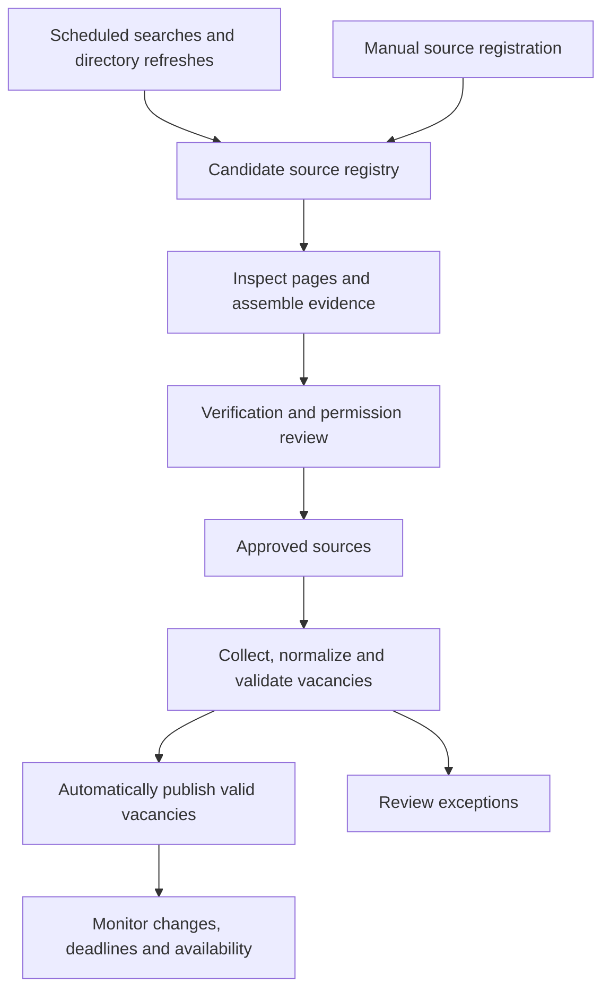

# Nurse.ng automated recruitment-source discovery and management

Research and documentation date: 7 November 2026.

Status: the user authorised implementation, and source discovery, administrative review and a first structured vacancy ingestion/publication increment are implemented. The full recruitment pipeline below remains the target, not a claim of completed functionality. This document supersedes the earlier proposal to defer automated discovery. No paid search account or paid search API calls were used. See [operating instructions](RECRUITMENT_SOURCE_OPERATIONS.md) and the progress table below.

## Required outcome

Nurse.ng independently finds institutions and recruitment channels, assembles evidence and registers pending candidates. Administrators review sources instead of locating every website. Manual URL registration remains available. Approved sources then supply vacancies through one shared collection, validation, publication and lifecycle pipeline.

Automated discovery is in the first release. A scheduled collector that only visits a list supplied by administrators does not satisfy the requirement. Country/category settings and a few initial directory/provider integrations configure how discovery operates; they are not an exhaustive list of allowed institutions or websites.

The exact supplied source is https://lshsc.ng/recruitment. Retain it as the original source address. Any redirects, HTML canonical hints, alternate links or proposed API endpoints are observations in separate fields; they must not overwrite or silently replace this address.

## Existing project fit

At the initial inspection, the application used FastAPI, SQLAlchemy, Alembic and server-rendered pages. Its jobs feature supported basic employer posting and consented applications, but no source registry, discovery scheduler, approval evidence, collection worker or provenance pipeline was found. That model required an employer user and assumed naira salaries. The shared model now also accepts approved-source vacancies, explicit vacancy countries and disclosed currencies/pay periods. Legacy countries stay unknown where never recorded. Existing employer publication relies on a self-selected role (tracked as A03); direct employer trust safeguards remain necessary.

The increment keeps the existing application and one logical database, adding domain modules and an independently run worker. PostgreSQL runtime/concurrency and migration verification remains necessary before production background collection; current verification uses SQLite.

## Implementation progress — 7 November 2026

| Capability                              | Current delivery                                                                                                                                                                                      | Remaining work                                                                                                                        |
| --------------------------------------- | ----------------------------------------------------------------------------------------------------------------------------------------------------------------------------------------------------- | ------------------------------------------------------------------------------------------------------------------------------------- |
| Organisation/source registry            | Implemented: exact original URL, separate observed/canonical addresses, country, provenance, review, permission, automation and health states; manual registration                                    | Safe entity merging across independent providers; richer jurisdiction policies                                                        |
| Independent directory discovery         | Implemented: paginated ROR healthcare discovery, Nigerian and worldwide schedules, recruitment links and bounded sitemap inspection, automatic pending registration                                   | Broader official government/facility/agency directory coverage; ROR is incomplete                                                     |
| Search discovery                        | Brave adapter implemented, disabled until an API key and result-storage permission reference are configured                                                                                           | Obtain appropriate provider rights, activate, and evaluate coverage; no live paid search validation yet                               |
| Approval and audit                      | Implemented: staff-only review, five evidence checks, expiry, pause/revoke/reopen, stale-review protection and recorded events                                                                        | Operational review ownership and jurisdiction-specific evidence standards                                                             |
| Background operation                    | Implemented: persistent queue, one network task at a time, hard process deadline, leases, retries, daily attempt/queue caps and persistent cooldown                                                   | Production PostgreSQL concurrency validation, deployment supervision, telemetry and retention policy                                  |
| AI assistance                           | Not implemented; no model/provider selected                                                                                                                                                           | Labelled examples, extraction/classification evaluation, costs and data-processing permissions                                        |
| Vacancy ingestion and lifecycle         | Implemented for configured HTML sources with schema.org JobPosting data: original snapshots, normalization, validation, URL deduplication, automatic publication, exceptions, deadlines and freshness | Live source activation with verified reuse rights; more adapters, independent application-link checks and explicit withdrawal signals |
| Employer trust and integrated discovery | Both channels share `/jobs`, search and country/type filters; aggregated vacancies link to the original announcement                                                                                  | A03 employer safeguards, profile matching, saved jobs and notifications                                                               |

A live read-only check of the implemented ROR adapter returned 18 usable Nigerian institution candidates from 20 records. This proves directory-to-website discovery, not current ownership or recruitment availability; some returned domains appear historical. Fixture-based tests exercise previously unseen Nigerian and New Zealand institutions through recruitment-page discovery. Exact `https://lshsc.ng/recruitment` preservation is tested across redirects and canonical hints. Test and migration evidence is recorded in the work log after verification.

## Research evidence

### Search providers

Brave documents a Web Search API with API-key authentication, language/country targeting, domain searches, pagination and freshness filters. Public Search pricing observed is USD 5 per 1,000 requests. Its standard terms restrict persistent storage/caching and creating a database of Search Results; its product page says storage rights are available on an appropriate plan. A Nurse.ng provider agreement must explicitly cover persistent source records, discovery evidence, permitted AI processing and the intended use. Storing only URLs or fetching the destination separately must not be assumed to bypass a provider's contractual restrictions. The basic public price is not a quote for the required rights.

Brave's quota documentation describes HTTP 429 and rate-limit response headers. Respect the actual account's limits, not illustrative header values or an unlimited interpretation of advertised capacity.

Google's Custom Search JSON API documentation says it is closed to new customers, with existing users required to transition by 1 January 2027. Microsoft's old Bing Search APIs were retired on 11 August 2025. Neither should be selected from an outdated implementation tutorial. Exa also documents a web-search API, but its suitability, retention rights and cost were not fully assessed here. Keep a provider interface so the application is not tied to one vendor.

Sources:

- https://api-dashboard.search.brave.com/documentation/services/web-search
- https://api-dashboard.search.brave.com/documentation/pricing
- https://api-dashboard.search.brave.com/documentation/resources/terms-of-service
- https://api-dashboard.search.brave.com/documentation/guides/rate-limiting
- https://brave.com/search/api/
- https://developers.google.com/custom-search/v1/overview
- https://learn.microsoft.com/en-us/lifecycle/announcements/bing-search-api-retirement
- https://docs.exa.ai/reference/search

### Directories and institutional links

Nigeria's Federal Ministry of Health hospital directory and teaching-hospital list were inspected earlier this session. They supply institution names/categories from which discovery can perform website lookups; a directory need not provide every recruitment URL to be useful. CAC's homepage links to its public corporate search. CAC evidence supports relevant legal-entity checks, not facility licensing, agency authorisation or recruitment-channel approval.

ROR provides an organisation search/filter API and downloadable registry data. Its schema includes healthcare organisations, websites, countries/locations, identifiers and organisational relationships. The published data dump is CC0. One live query returned LUTH and LASUTH records with Nigerian locations and website addresses. This demonstrates institution-to-website discovery without entering each website. The query also returned loosely related international records: search relevance is not identity verification. ROR is a research-organisation registry with incomplete coverage of healthcare employers/agencies; use it as supplementary evidence/discovery, not an exhaustive hospital list or licensing authority. Follow the applicable attribution rules for any separately used datasets.

Institutional homepages inspected earlier linked their careers/internship pages, including National Hospital Abuja, LASUTH, UBTH and Iwosan Lagoon. Their career pages showed no current openings, a closed exercise or general guidance. These remain possible recruitment channels even when no vacancy is currently open.

A Nigerian facility-registry endpoint returned a certificate-hostname error; an NHS organisation-directory page returned 403. Neither is treated as a confirmed integration or as proof that the institution/dataset is invalid.

Sources:

- https://health.gov.ng/hospitals/
- https://health.gov.ng/teaching-hospitals/
- https://www.cac.gov.ng/
- https://ror.readme.io/docs/rest-api
- https://ror.readme.io/docs/ror-data-structure
- https://ror.readme.io/docs/data-dump
- https://api.ror.org/v2/organizations?query=Lagos%20University%20Teaching%20Hospital

Sitemaps and institutional navigation expose potential recruitment URLs; dates/labels can be wrong and must be checked. Common Crawl offers a URL index and historical crawled content. It can help find old or obscure institutional addresses later, but old crawl records cannot establish current vacancies, authority or reuse rights. Its terms do not guarantee accuracy or grant unrestricted rights to underlying third-party content.

Sources: https://www.sitemaps.org/protocol.html ; https://commoncrawl.org/overview ; https://commoncrawl.org/terms-of-use

## Discovery architecture

Operate two continuous loops:

1. Discovery loop: geographic/category planner → licensed search and directory adapters → candidate organisations/URLs → bounded public-page inspection → relevance classification and evidence collection → pending source registry → source approval.
2. Vacancy loop: approved sources → collection adapters → original records → extraction/normalization → validation and deduplication → ordinary automatic publication or exception review → expiry/change/freshness monitoring.

Manual registration enters the same pending/evidence workflow, with the submitting administrator and exact original URL recorded. It does not grant approval. Discovered opportunities and source pages may help find additional organisations, but must obey the same discovery access and verification controls.

### How the discovery loop runs without individual URLs

Maintain geographic scope, languages, organisation categories and query templates as data. For Nigeria, cycle across all states and the FCT and categories including federal/state ministries, health commissions, teaching hospitals, FMCs, specialist/private hospitals, agencies and government recruitment portals. Include state-specific terms, institution aliases and "nursing", "midwifery", "internship", "vacancies", "careers", "recruitment" and local equivalents. Do not require every institutional homepage to mention nursing; a general hospital or government recruitment portal can be a relevant source with vacancy-level nursing filtering.

In parallel, refresh authoritative institution directories. An institution name creates a targeted website search; a website creates a bounded recruitment-page search. Inspect navigation, sitemap indexes, links, feed declarations and visible structured metadata. Recognise locally used terms and scripts. A link to an external ATS creates a proposed organisation-to-ATS relationship, requiring tenant/path and channel confirmation; a shared ATS domain does not approve every tenant.

Store each discovery event with method, timestamp, query/directory reference, parent link and evidence permitted for retention. Deduplicate equivalent leads while preserving different legal entities, branches and recruitment endpoints. Do not merge by domain/name alone: one government domain can host many institutions, and one institution can use several domains.

A persistent crawl frontier records URLs queued, attempted, deferred or completed, including depth, domain budget, retry time and reason. Avoid repeatedly paying for the same searches or traversing infinite URL calendars/filters. Periodically revisit quiet sources and directories because nursing recruitment may be seasonal. Allocate a minimum discovery budget across underserved regions/categories rather than spending everything on high-volume English-language sites.

Countries are registry data, not an enum containing five launch countries. Candidates from newly encountered countries can be registered immediately. Unknown verification/licensing rules keep them pending; they do not disappear or become trusted by default. A first release should exercise Nigerian and at least one international discovery path, with a known/new-country case to demonstrate extensibility. No architecture can promise exhaustive worldwide web coverage or instant access to unindexed/offline announcements.

## Verification and registry

All candidates begin pending, and have five separately evaluated evidence questions:

1. Organisation identity: government/institutional directory, legal entity record where applicable, official identifiers and jurisdiction. A public hospital should not be rejected merely because it lacks a private-company registration.
2. Domain association: independent authoritative links and corroborating records; institutional contact verification when necessary. HTTPS, a government-looking logo, search rank and domain suffix are not sufficient alone.
3. Recruitment authority: an official site's recruitment link, an endorsed outsourced ATS or confirmed agency mandate. Store who is hiring, who is recruiting and who owns/publishes the channel separately.
4. Required registration/licensing: apply the requirements for the country, state/province, organisation category and recruitment activity. Agency licensing may be required, not required or unresolved; do not invent a universal licence requirement. Preserve documented reasons for not-applicable checks.
5. Collection and reuse: allowed access route, terms/licence/permission evidence, robots directives, rate limits, scope of excerpts/full text, AI processing, storage/retention, attribution, redistribution and expiry. Public access does not settle all these questions.

Evidence collection and mechanical checks are automated where permitted. Initially, an authorised staff reviewer signs source approval after required checks pass. Reviewers receive an evidence packet and outstanding questions rather than a bare URL. Jurisdiction policies are maintained once per category/activity and reused across sources. Any later automatic approval needs an explicitly approved deterministic policy and trustworthy evidence; model confidence cannot approve a source.

A source registry must include:

- Organisation name, aliases, category, legal/registry identifiers, country and locations; parent/branch and agency/employer relationships.
- Exact original/submitted/discovered URL, website, recruitment page, observed redirect/canonical URLs, aliases and their evidence. For LSHSC, retain https://lshsc.ng/recruitment unchanged.
- Source type, adapter/method, external-ATS tenant/path where relevant, parser version and supported fields.
- Verification state, required checks, supporting evidence, reviewer, decision time, policy version, next recheck and revocation history.
- Access/reuse permissions, terms versions, restrictions, expiry/retention, attribution and secrets references.
- Automation state, fetch health, last attempt, last successful check, last content change, last vacancy discovery, consecutive failures and next scheduled attempt.
- Discovery lineage, review assignment, review reasons and audit history.

Keep distinct state dimensions: verification (pending/in review/approved/rejected/revoked); access/reuse (unknown/permitted/limited/denied/expired); automation (off/testing/active/paused/manual); health (healthy/timeout/TLS error/blocked/rate-limited/parse error). Empty careers pages are a content outcome, not a verification failure. "Last successful check" never substitutes for "last verification".

Source rejection requires supported reasons such as confirmed impersonation or irrelevance. HTTP 403, timeouts and unavailable pages create operational observations, bounded retries and follow-up; they do not prove invalidity. A denied collection method can coexist with a genuine organisation. Use an authorised API/feed, agreed export, employer submission or administrator-assisted entry within applicable rights instead. Do not use alternate proxies, disabled TLS or CAPTCHA bypass to defeat restrictions.

Admin UI should offer filters by jurisdiction/category/state, duplicate suggestions, evidence comparison, outstanding checks, assignment, approval/rejection with reasons, adapter testing, pause/revoke and history. Batch triage can reduce effort but must not hide missing source-specific evidence. Changes of domain, permissions, ownership or application destination trigger re-evaluation. Rediscovery must not silently reactivate revoked/rejected sources.

## AI and conventional software

Conventional software controls scheduling, quotas, URL fetching, allowed network destinations, robots/permission enforcement, identity keys, schemas, date/currency parsing, database constraints, approval permissions and publication gates.

AI can propose query variations; classify institution/page type; identify likely careers links among fetched links; extract vacancy fields with source quotations; map nursing terms across languages; propose duplicate matches; explain meaningful changes; and flag inconsistent or suspicious records. Use deterministic API/RSS/structured parsers first and AI for ambiguous layouts or language. Do not repeatedly send unchanged content for inference.

Every AI result is untrusted structured output with field evidence, missing values and uncertainty. Record content hash, parser/model/prompt version and applicable extraction rules. A schema-valid result may still be wrong, so compare critical fields to the original evidence and source-specific rules. Generic recruitment instructions must not be interpreted as the requirements of a particular open job. Null means unknown; inferred tags remain distinct from source facts. Source API/page text and model context can be truncated, so detect incomplete documents.

Duplicate decisions begin with source IDs, requisition references and confirmed organisation identity. AI can suggest semantic similarity, but cannot silently merge different recruitment rounds. Changes start with hashes and structured diffs; AI can explain them but cannot reset a deadline or revoke trust by itself. Material uncertainty enters review. Routine validated vacancies from approved sources publish automatically without per-vacancy staff approval.

Do not grant the extraction model credentials, approval/database-write tools or unrestricted network access. An external page can contain malicious instructions; trust boundaries must exist in executable permissions outside the prompt. If a query-planning model is used, every proposed query/URL still passes through budget and fetch controls. Avoid automatically deploying AI-generated scraper code. Use versioned adapters or constrained extraction configurations tested against permitted fixtures.

Source: https://cheatsheetseries.owasp.org/cheatsheets/LLM_Prompt_Injection_Prevention_Cheat_Sheet.html

## Exact LSHSC treatment

The exact URL https://lshsc.ng/recruitment was opened in a browser with certificate verification enabled, including a repeat inspection during this design review. The repeat completed after a substantial delay and browser network-service errors, and returned the same recruitment-guidance content. Such attempts need an enforced worker deadline in production. Curl failed certificate-chain validation. The page presents recruitment guidance, says approved exercises and application periods will be announced, and does not identify a specific open nursing vacancy. Its general document-preparation guidance is not a vacancy requirement. HTML exposes a WordPress page-content endpoint; that is not proof of a dedicated vacancy API or permission for bulk reuse.

Register it as a manually supplied pending source in the proposed design, preserve the exact original address, record observed access behaviour, collect institution/channel/permission evidence and test the approved collection method. Other links found on the page are additional leads rather than replacements. Discovery must continue independently across other institutions; this example is neither a prerequisite nor the limit of coverage.

## Security, reliability and cost

The discovery fetcher must be able to inspect previously unknown public domains, so requiring staff to pre-approve every URL before discovery would defeat the requirement. Give it tightly restricted public-internet egress, no applicant/internal-system credentials, and bounded read-only fetches after access-policy checks. Block private, loopback, link-local and cloud-metadata destinations, including IPv6, DNS rebinding and redirect hops. Approved collection workers use narrower origin/path scopes. Keep browser rendering isolated with fresh profiles and no signed-in accounts; use it only when permitted and necessary. Bound documents, decompression, timeouts and redirects; disable XML external entities and sanitize displayed HTML.

Keep applicant/profile data out of discovery queries and external-model requests. Apply data minimisation and retention to raw snapshots, which can include personal contact details. Staff approval accounts need appropriate access controls and audit; the existing employer/application privacy safeguards must survive recruitment changes.

Use a durable work queue, per-domain concurrency limits, leases, retry/backoff/jitter and circuit breakers. A single scheduler should not be accidentally duplicated by web workers. At-least-once delivery requires idempotent ingestion; source approval, vacancy publication and downstream events must stay consistent. Recheck permission/approval at publication time, including after queued work waited for review. An outbox can prevent lost or duplicate notifications. Maintain expiry/freshness jobs even when upstream sources fail, and keep original records and revisions within permitted retention.

Keep discovery refresh and vacancy polling separate. Illustrative schedules might run discovery daily, directory refresh weekly and approved-source vacancy checks at source-appropriate intervals; these are proposals, not provider SLAs. Use conditional HTTP requests and content hashes where supported. Respect source-specific rules even if they require slower collection.

Public Brave Search pricing implies 3,000 requests/month costs USD 15 and 20,000 costs USD 100 before credits/tax and any agreement needed for storage rights. This is only search usage, not the whole system. Total cost also includes fetch/render/OCR compute, model input/output tokens, database and retained records/backups, monitoring and review/adapter-maintenance labour. A search-provider request can return multiple leads; most leads are not immediately approved sources. Cap per-day search requests, candidate pages, rendered pages, model tokens and review intake. The review queue can become the bottleneck even when search is inexpensive.

Measure cost per distinct relevant candidate and per approved source, plus human review minutes. Avoid inventing a monthly infrastructure estimate before traffic/source volumes and operating arrangements are known. No monetization strategy is included.

## Realistic implementation sequence and acceptance criteria

First release includes all of the following, delivered as small increments:

1. Source/organisation registry, separate state dimensions, evidence and admin review; exact URL preservation and manual registration.
2. A scheduled automatic discovery loop using at least one permitted directory and one suitably licensed search provider, institutional link/sitemap inspection, deduplication and automatic pending registration. Nigeria is prioritised; demonstrate international discovery and acceptance of a newly encountered country without schema/code changes. Source discovery must not wait until a later release.
3. Conventional classification/extraction plus narrowly scoped AI assistance where a small evaluation set shows value; evidence and missing fields are mandatory. No model may approve sources or bypass collection restrictions.
4. One permitted collection adapter, raw/normalized vacancy records, ordinary automatic publication, exception review, expiry/change monitoring and unified search. This validates the full journey from independently discovered source to published vacancy.

Acceptance checks: with no manually entered hospital URLs, a scheduled run obtains organisation names from a permitted directory/search query, finds recruitment pages and creates pending records with provenance; repeating the run produces no duplicate sources. The exact LSHSC URL survives inspection and canonical hints unchanged. Unknown-country candidates remain eligible for review. Unapproved/revoked sources and unpermitted methods cannot publish. An approval expires/revokes safely even while work is queued. Timeouts/TLS/403 errors preserve identity evidence and log health failures. Empty or closed recruitment pages produce no open jobs. A normal valid record from an approved source publishes without individual approval; ambiguous deadlines/domains enter review. Malicious webpage instructions cannot alter approval, trigger internal fetches or leak secrets.

Use a representative labelled sample of institutions and recruitment pages across Nigerian regions, public/private categories and some international jurisdictions. Measure relevant-candidate precision, directory coverage, recruitment-page discovery recall within that sample, correct employer/domain association, extraction accuracy for critical fields, duplicate/merge errors, publication freshness and review effort. Include unseeded/held-out institutions so a crawler of only a known list cannot pass. Whole-web recall is not measurable; avoid claims of finding every vacancy.

Later capabilities: more directory/provider adapters and jurisdiction rules; multilingual expansion; provider failover; permitted PDF/OCR and complex browser sources; active learning from review outcomes; low-risk deterministic approval policies where justified; historical-link discovery with Common Crawl; larger worker fleets if measured backlog requires them. A second search index is useful for coverage and resilience, not a reason to add several vendors at launch.

Open decisions before activation: provider rights for persistent discovery records and AI processing; applicable licensing evidence by jurisdiction/activity; review ownership; permitted first vacancy feed; discovery/freshness budgets; snapshot retention; model/provider selection and evaluation thresholds. These decisions do not turn manual URL discovery into a dependency. The platform should do the finding; people remain responsible for the policy and unresolved trust decisions.

## Vacancy increment evidence — 7 November 2026

The configured JobPosting collector now completes the path from an approved source through retained raw content, normalization, validation and automatic ordinary publication into `/jobs`. Staff review handles exceptions without bypassing source permission or freshness gates. Public status checks use recorded deadlines and a 48-hour confirmation window; source failures and missing announcements stop presenting jobs as open. [Operating instructions](RECRUITMENT_SOURCE_OPERATIONS.md#enabling-structured-vacancy-collection) describe activation and limitations.

The full suite passed **280 tests in 175.04 seconds**. Isolated browser checks passed source collector configuration, automatic publication, international salary display, external application presentation, exception review, and mobile/desktop layouts. Migration `3838cd201521` preserved original values across the 24 existing local tables, with 27 tables afterwards, valid foreign keys and no schema drift.

The saved exact LSHSC page yielded zero JobPosting records. No live source approval or fabricated vacancy was added. The working pipeline is verified with isolated fixtures; actual source activation still requires verified ownership, compatible data and reuse rights. Broader adapters, AI, application-link monitoring, saved jobs and notifications remain open.

### Live activation follow-up — 7 November 2026

Source review now accepts a documented legal basis (including applicable government-publication rules), published terms or written authorization. A separate licence is not compulsory. Explicit collection, full-snapshot retention and republication findings bind the permitted URL scope. Collector configuration cannot broaden that scope; redirect checks enforce it before requesting a destination. Reapproval requires collector reconfiguration. Staff can see why activation is blocked, separately from page health or whether an open vacancy exists.

Migration `49b37f820e16` preserves historical evidence and initializes granular rights as unrecorded. Existing approvals require scope review before collection resumes. The exact LSHSC source remains pending; [its saved activation review](LSHSC_ACTIVATION_REVIEW.md) records the current page, HTTPS behavior and remaining evidence/format work. This increment does not claim live recruitment coverage.

## Automatic activation update — 8 November 2026

Sources meeting the reproducible checks now activate and configure collection automatically. The initial policy uses fresh matching active ROR healthcare evidence, an exact HTTPS official recruitment channel, a direct homepage link, an explicit page-level CC0/CC BY licence, compatible structured vacancies and unambiguous deadline handling. Ambiguity goes to staff review with reasons; staff decisions are preserved. Checks renew a 48-hour automatic approval and stop publication when evidence fails. See [operating instructions](RECRUITMENT_SOURCE_OPERATIONS.md#automatic-activation) for exact coverage and limitations. This replaces the earlier universal staff-approval requirement; government sources can still use other documented legal bases through staff review.

## Nigerian opportunity priority — 8 November 2026

The current product scope prioritises Nigerian federal/state and private opportunities, health/digital-health roles, and youth fellowships, internships and graduate programmes across sectors. Examples such as National Health Fellows and Nigeria Jubilee Fellows inform the categories; discovery is not restricted to those programmes. This supersedes the earlier nursing-title-only relevance rule. Nigerian sources and jobs rank first, the bounded worker queue prefers Nigerian work four to one, and the built-in worldwide directory schedule is weekly. Search covers all states/FCT plus national opportunities, cycling categories within each area. Eligibility, evidence, access, reuse and deadline checks continue to apply. See [L84](DECISIONS.md#l84--prioritise-nigerian-opportunities-across-sectors-and-career-stages) and the [operating instructions](RECRUITMENT_SOURCE_OPERATIONS.md) for setup and remaining adapter limitations.

## Implementation update — 9 November 2026

The earlier ROR-only/licence-only activation policy and Brave-only search requirement are superseded by [Search and recruitment discovery](SEARCH_DISCOVERY.md). Python now orchestrates self-hosted SearXNG JSON search, instance failover and optional Brave fallback in the existing durable worker. Direct monitoring remains independent. Automatic factual indexing verifies government domains, current independent directory identities and authoritative publisher/portal links without claiming full-content reuse rights. Historical full-content collectors retain their original permission requirements.
