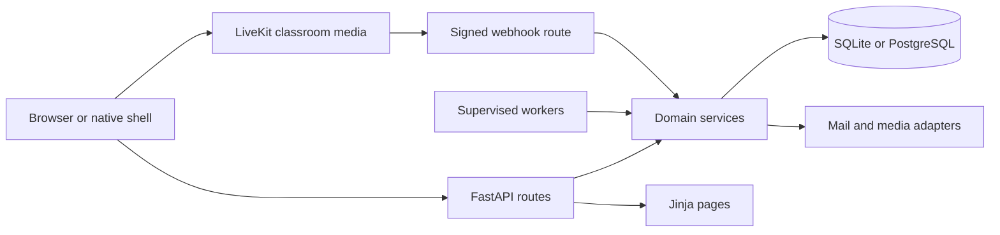

# Understanding the Nurse.ng code

This guide is the starting point for a maintainer returning to the project. It
explains where behavior belongs, how a request reaches the database, and which
boundaries must remain intact when a feature changes. The [live learning guide](LIVE_LEARNING_ARCHITECTURE.md)
walks through the new educator, course and classroom domain in more detail.

The [documentation index](README.md) connects all current guides. Use the
generated [backend](reference/BACKEND.md), [routes](reference/ROUTES.md),
[schema](reference/SCHEMA.md), [frontend](reference/FRONTEND.md),
[configuration](reference/CONFIGURATION.md), [tests](reference/TESTS.md) and
[infrastructure](reference/INFRASTRUCTURE.md) references when looking for a
particular file, symbol, field or endpoint. They include source links and can be
refreshed after code changes; [maintenance](MAINTENANCE.md) explains the daily workflow.

## Read these files first

1. `app/main.py` assembles the FastAPI application, middleware, error handlers,
   static files and feature routers. It is the map of the running application.
2. `app/core/config.py` defines environment settings and validates the production
   origin, hosts, cookies, signing key and database connection. Production reads
   the process environment; the local `.env` is a development convenience.
3. `app/web/deps.py` resolves the current account, checks its persisted session
   version, and provides member/staff and CSRF dependencies.
4. `app/db/session.py` provides a database session for a request and enables
   SQLite foreign keys. `app/db/base.py` supplies common IDs and timestamps.
5. `app/web/templating.py` builds the common page context, supplies CSRF tokens,
   and integrates feedback, private drafts, notifications and activity recording.

Then follow one feature from its route into its service, model and tests. For
example, course enrollment begins in `app/web/education_routes.py`, calls
`app/services/education.py`, and writes `LearningEnrollment` from
`app/models/education.py`. Its HTTP behavior and domain invariants have separate
tests so a rendering change cannot silently replace the authorization check.

## How the application is organized

| Directory | Responsibility | What belongs elsewhere |
| --- | --- | --- |
| `app/core/` | Settings, security primitives, storage and shared validation | Feature-specific permission decisions |
| `app/models/` | Database records, relationships, constraints and identity | HTTP responses and external provider calls |
| `app/services/` | Domain rules, transactions, work queues and provider adapters | HTML rendering and browser state |
| `app/web/` | Route input/output, dependencies and presentation context | Reimplementation of domain rules |
| `app/templates/` | Accessible server-rendered pages and reusable components | Secret values and authoritative permission checks |
| `app/static/` | Scoped CSS, browser behavior and public assets | Private uploads, credentials and database files |
| `migrations/versions/` | Versioned changes from an existing database to the current schema | Runtime model imports that could change an old migration |
| `tests/` | Isolated domain, HTTP, migration, browser and hosting checks | Changes to real members or outbound development email |
| `deploy/` | Production process startup and host-specific setup | Member-facing product explanations |
| `mobile/` | Native app packaging around the hosted experience | The Python application's root/build directory |

The application is a domain-organized monolith. A single web application shares
one database with supervised recruitment, Reels and notification processes. The
live classroom's media transport runs in LiveKit; its teaching permissions,
registrations and learning records remain in Nurse.ng.



## Request lifecycle and permissions

A normal member action follows this sequence:

1. Middleware rejects an unlisted host and verifies the signed session cookie.
2. The current-user dependency loads the account and checks active status and
   `auth_version`. Resetting a password can revoke older sessions in the database.
3. A mutation validates the CSRF token. Classroom JSON uses `X-CSRF-Token`;
   ordinary forms use a hidden `csrf_token` field.
4. The route normalizes browser input and calls a domain service. User identity
   and content ownership come from the server, never a submitted `user_id`.
5. The service validates current access and performs its transaction. Unique
   constraints and conditional updates protect retries and concurrent writes.
6. The route renders or redirects with a server-confirmed result. Browser
   enhancement adds pending/error behavior to the ordinary HTML form.

Account type, public profile visibility, community participation, educator
approval and staff access are separate concepts. A teaching application does
not grant staff access. Enrollment does not grant course editing. A public
community does not imply private membership. Keep these distinctions in the
service that owns the action, even when the page also hides an unavailable button.

## Feature ownership map

Names in this table are files under `app/web/`, `app/services/` and `app/models/`
respectively; the references above link every file and symbol. Tests are under
`tests/`, with focused browser runners under `tests/browser/`.

| Feature | HTTP owner | Domain owner | Persisted records | Starting tests |
| --- | --- | --- | --- | --- |
| Registration, login, dashboard | `auth_routes.py`, `routes.py` | `auth.py`, participation `progress` | `user.py`, `participation.MemberJourney` | `test_auth.py`, `test_auth_hardening.py` |
| Recovery, email, photos, deletion | `account_routes.py`, `pages_routes.py` | `accounts.py`, `account_mail.py` | `account.py`, `User.auth_version` | `test_account_management.py` |
| Google/LinkedIn login/linking | `social_routes.py` | `social_auth.py` | `social_auth.py` | `test_social_auth.py` |
| Professional profile/sharing | `profile_routes.py` | `profiles.py` | `profile.py` | `test_profiles.py`, `test_profile_pages.py`, `test_profile_sharing.py` |
| Optional welcome and member discovery | `onboarding_routes.py`, `community_routes.py` | `member_interests.py`, `member_discovery.py` | `User`, `NurseProfile`, visibility rows | `test_member_discovery.py` |
| Public posts/replies, follows and network | `community_routes.py` | `community.py` | `community.py` | `test_community.py`, `test_discussions.py`, `test_reply_context.py` |
| Communities, Helpful and selected answers | `community_growth_routes.py` | `community_growth.py` | `CommunityMembership`, `HelpfulReply`, `CommunityAnswer` | `test_community_growth.py` |
| Public destination sharing | `community_growth_routes.py` | `community_sharing.py` | Signed destination; no personal attribution record | `test_community_sharing.py` |
| Next-step reminder, introductions/welcomes | `participation_routes.py` | `community_participation.py` | `MemberJourney`, `CommunityIntroduction` | `test_participation.py` |
| Peer support/report review | `participation_routes.py` | `mentorship.py` | `MentorOffer`, `Mentorship`, `MentorReport` | `test_participation.py` |
| Recurring community activities | `participation_routes.py` | `community_participation.py` | `ActivitySeries`, `ActivityOccurrence`, `ActivityAttendance` | `test_participation.py` |
| Personal invitations and weekly digest | `participation_routes.py` | `member_invitations.py`, `weekly_digest.py` | Referral and digest records in `participation.py` | `test_participation.py` |
| Guided interface tour | `tour_routes.py` | `tours.py` | `tour.UserTour` | `test_tours.py` |
| Private conversations/attachments | `messages_routes.py`, `message_upload_limits.py` | `messages.py`, `message_attachments.py` | `messages.py` | `test_notifications.py`, `test_message_attachments.py` |
| Inbox and opted-in email | `notification_routes.py` | `notifications.py`, `notification_worker.py` | `notifications.py` | `test_notifications.py` |
| Likes and safety moderation | `engagement_routes.py`, `moderation_routes.py` | `engagement.py`, `community.py` | `PostLike`, `ContentReport` | `test_likes.py`, `test_community.py` |
| Reels upload/playback | `reel_routes.py` | `reels.py`, `reel_worker.py` | `reels.py`, `CommunityPost`, `CommunityMedia` | `test_reels.py` |
| Native employer jobs/applications | `jobs_routes.py` | `jobs.py`, `employers.py` | `jobs.py`, `employers.py` | `test_workspace_flows.py`, `test_employer_approval.py` |
| Opportunity saves/matching/reminders | `opportunity_routes.py` | `opportunity_watch.py`, `opportunities.py` | `opportunities.py` | `test_opportunity_watch.py` |
| Source discovery/search/approval | `recruitment_routes.py` | `recruitment*.py`, `factual_opportunities.py` | `recruitment.py` | `test_recruitment.py`, `test_recruitment_search.py`, `test_automatic_activation.py` |
| Vacancy extraction/review/publication | `vacancy_routes.py` | `vacancies.py`, `vacancy_*.py`, `announcement_extraction.py` | `vacancies.py`, `Job` | `test_vacancy_ingestion.py`, `test_vacancy_duplicates.py` |
| Employer approval | `employer_routes.py` | `employers.py` | `employers.py` | `test_employer_approval.py` |
| Private document review | `profile_routes.py`, `review_routes.py` | `verification.py`, `evidence.py` | `verification.py` | `test_verification.py`, `test_evidence_safety.py` |
| Educators, courses, lessons and quizzes | `education_routes.py`, `education_common.py` | `education.py` | `education.py` | `test_education.py`, `test_education_routes.py` |
| Live media, attendance and recordings | `education_classroom_routes.py` | `education.py`, `education_live.py`, `education_notifications.py` | Sessions, grants' source state, attendance/recording receipts | `test_education_live.py`, `test_education_notifications.py` |
| Events and calendar export | `event_routes.py` | `events.py` | `events.py` | `test_events.py` |
| Offline reading/drafts/sync | `offline_routes.py` | `offline.py`, `offline_content.py`, `offline_uploads.py`, `learning.py` | `offline.py`, `offline_upload.py`; encrypted browser records | `test_offline.py`, `test_offline_uploads.py`, `test_offline_content.py` |
| Usage analytics and staff grants | `activity_routes.py`, `staff_routes.py` | `activity.py`, `staff.py` | `UserDailyActivity`, `StaffRoleEvent` | `test_activity.py`, `test_admin_management.py` |
| Worker recovery and readiness | `routes.readyz`, CLI/deployment | `worker_runtime.py`, `worker_health.py` | `WorkerHeartbeat` and feature leases | `test_worker_operations.py`, `test_hosted_processes.py` |
| Consistent local backup/restore | CLI | `backups.py` | Private backup manifest/database/files | `test_backups.py` |

## Trace the important workflows

**Dashboard reminder.** `dashboard` reads participation progress. Its template
shows the card when there is no `MemberJourney` or no `dismissed_at`. The next-step
form submits `dismiss=yes` only for **Save and hide the reminder**; the ordinary
save clears dismissal. Profile, tour and community milestones are independent.
See [the exact rule](DASHBOARD_ONBOARDING.md).

**Private message.** `messages_routes.send` resolves the recipient from the server,
checks CSRF and calls `messages.send_message`. The service requires a current
accepted connection, validates body/attachments, resolves an optional client retry
key, inserts the message and appends its notice in the same transaction. Attachment
flows lock accounts in stable order and recheck the session/connection. Retrying
the same key with different content fails. The browser marks only rendered incoming
IDs as read; the update stream can replay unseen messages behind a cursor.

**External opportunity.** A source route records/enqueues an observation. The
recruitment worker claims it with a lease token, runs bounded network discovery
in a child, and applies results only while it still owns the claim. Source
authority/reuse assessment is distinct from extraction. The vacancy pipeline saves
collection evidence, normalized facts and review state, then creates an eligible
public `Job` when its publication conditions hold. External jobs use the publisher's
application process; native employer jobs use the consented Nurse.ng application.

**Live learning.** Authoring routes validate educator/course ownership. A learner
registers for a session with atomic seat allocation. Classroom routes recheck
account/educator/session state before issuing short-lived room grants. Only raw
provider webhook verification followed by transactional replay handling establishes
provider attendance and completed recording metadata. Enrollment, a seat and a
browser media connection are different states. Recordings require current course
authorization before a private expiring download URL is issued.

**Offline change.** Browser consent prepares encrypted account-scoped snapshots
and explicit drafts. A supported queued operation sends a stable ID and payload;
the server rechecks current access/state and commits the result with its receipt.
A matching retry returns that receipt; a changed payload conflicts. A queued draft
or fully transferred Reel is not proof of delivery or public-ready video. See
[offline architecture](OFFLINE_ARCHITECTURE.md).

## Runtime and import boundaries

`Settings`, the database engine and several browser/service registries are created
at import time. Tests set their isolated environment before importing the app and
override `get_db`; changing a production environment variable requires restarting
affected processes. Request session closure does not automatically commit writes.

FastAPI runs synchronous route handlers through its thread pool. Async upload/JSON
handlers explicitly manage blocking work; bounded provider/network work must not
block the ASGI event loop. Recruitment network checks and media parsers use child
processes for deadlines/resource isolation. Process-local rate limits are not shared
across multiple web processes; deployment currently selects one web worker.

The `notifications` worker name covers more than email: it also creates opportunity
and lecture reminders, advances recurring discussions, queues weekly digests and
maintains private message files. Keep it running when SMTP is disabled if these
in-app workflows are expected. `--once` runs bounded eligible work; it is not a
substitute for continuous scheduling. See [worker operations](WORKER_OPERATIONS.md).

## Data ownership and privacy

Use public identities only where the person deliberately chose to share them.
The account's `full_name`, contact fields and private professional profile do
not become public merely because the account participates in a classroom.
The classroom uses an educator's explicit display name or a member's community
name, with a generic learner fallback.

Private evidence, messages and recordings are authorized when accessed. A link,
reservation, old notification or browser cache is not a substitute for the
current permission check. Notifications retain record references, and their
visibility is recalculated before listing or delivery. Quiz answer keys stay
in the service/model layer and are not sent with an unanswered learner form.

Do not put private uploads under `app/static/`. Do not log provider responses,
bearer tokens, database URLs or account email tokens. `.env` and `.env.*` are
Git-ignored; examples contain setting names and instructions, not real secrets.

## Transactions and external services

Services normally commit the domain operation they own. The `notifications.emit`
helper is an exception by design: it appends notices inside its caller's
transaction and leaves committing and delivery to that caller/outbox.

Educator application/review and classroom state changes also accept
`commit=False` for a specific transaction boundary: the educator routes close
active provider rooms, update the sessions, and change approval in one database
unit. Those callers explicitly commit or roll back. Classroom mutations acquire
account, educator-profile and session locks in that order. Keep this order when
extending moderation, so a fresh start/token cannot race an approval change.

A database transaction cannot atomically commit an external video or SMTP call.
The classroom uses namespaced, stable room IDs, bounded provider calls and
serialized lifecycle decisions. The email outbox uses expiring claims and
bounded retries. Their documentation states the remaining retry semantics;
do not describe either boundary as exactly-once delivery.
If a later remote room deletion fails, earlier rooms may already be disconnected
even though the database changes roll back. A retry safely repeats those
deletions; this external boundary is described in the live learning guide.

For schema changes, add an Alembic revision and test an existing database upgrade.
Adding a SQLAlchemy column is insufficient for an installation already running.
Historical migration definitions must remain stable. Use SQL Boolean defaults
that work on PostgreSQL and SQLite, and explicitly enable SQLite foreign keys.

## Browser code and styling

The server-rendered page remains the foundation. Browser scripts enhance a
specific feature using documented `data-*` hooks. A script should initialize
only when its root element exists, explain failures, and release timers/media
when the page closes. Browser callbacks do not establish server authorization.

`app/static/css/appearance.css` defines shared light/dark/accessibility tokens.
Feature styles build on those tokens and are scoped to their feature root.
Learning styles load through `app/templates/education/base.html`, and the large
LiveKit SDK loads only on classroom pages. Keep reduced-motion, keyboard focus,
enlarged text and narrow-screen behavior as part of the component contract.

The [frontend guide](FRONTEND_GUIDE.md) documents the actual stylesheet cascade,
offline script order, public browser globals/events and the difference between
account-owned choices and browser-local display/install choices. The [data guide](DATA_GUIDE.md)
explains record ownership and why similarly named status/attendance fields differ.

## Making a change safely

1. Find the responsible route, service, model and focused tests with `rg`.
2. Identify the invariant being changed: ownership, lifecycle, data visibility,
   retries, ordering or external-service behavior.
3. Keep the change in its owning layer. Add a migration if persisted data changes.
4. Verify the actual behavior and the important failure/revocation path. Use
   isolated accounts, temporary databases and disabled/test mail transports.
5. Update the guide or module contract when an invariant or environment setting changes.

Useful checks from the repository root:

```sh
venv/bin/ruff check app tests
python3 tools/build_code_reference.py --check
venv/bin/python -m pytest tests/test_education.py tests/test_education_routes.py tests/test_education_live.py
venv/bin/python -m pytest tests/test_education_notifications.py
venv/bin/python -m pytest tests/test_migrations.py
venv/bin/python -m pytest
```

Browser and PostgreSQL runners have their own setup and isolation safeguards.
See [quality verification](QUALITY_VERIFICATION.md), [hosting](HOSTING.md), and
the feature-specific guide before running them. A passing local test is evidence
for the tested behavior; live provider, device and production acceptance need
their own recorded results.

## Documentation conventions

Each new module explains its responsibility and important boundaries. Public
functions explain the action, authorization and side effects. Inline comments
explain non-obvious reasons, such as atomic capacity allocation, raw webhook
verification, or invalidating quiz progress after a revised assessment. Prefer
clear names and short functions over comments that repeat each line of code.

When returning years later, start with this guide and `app/main.py`, then the
feature guide and its tests. Dated verification artifacts explain what was
demonstrated at a particular revision; they are not a replacement for current code.

See [the documentation maintenance contract](DOCUMENTATION.md). Generated source
maps are checked in CI. Add intent at the owning boundary and regenerate the map
with the change; do not fill simple helpers with comments that repeat their names.
