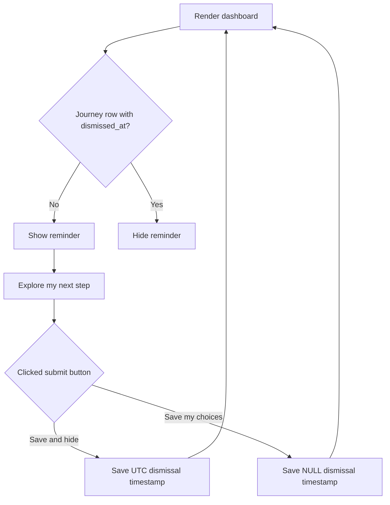

# When the dashboard next-step reminder disappears

The card headed **Find your next step in the nursing community** is an optional,
account-owned reminder. There is no completion checklist that automatically hides
it. The member decides whether to keep it.

## Member instructions

1. Click **Explore my next step** on the dashboard, or open `/community/start`.
2. Optionally choose **What brings you here?** and whether to show Helpful counts.
   Leaving the goal at **I'll explore first** is valid.
3. Click **Save and hide the reminder**.
4. Return to the dashboard. The card is hidden once the save succeeds.

No community membership, public introduction, profile completion, post, reply,
Helpful recognition, peer-support request, course completion or guided-tour
completion is required. A failed save does not hide the card.

The choice is stored in the account's database record, so it applies on other
devices when the same account signs in. **Save my choices** also saves the form,
but clears an earlier dismissal: using it later makes the reminder appear again.
The next-step page remains available after hiding the card.

## Exact code path

| Piece | Responsibility |
| --- | --- |
| [`auth/dashboard.html`](../app/templates/auth/dashboard.html) | Show the card if there is no journey row, or its `dismissed_at` is empty. |
| [`auth_routes.dashboard`](../app/web/auth_routes.py) | Pass `community_progress`, obtained from the participation service, to the dashboard. The signed-in `/` page also uses this function. |
| [`participation/start.html`](../app/templates/participation/start.html) | The hide button submits `name="dismiss" value="yes"`; the ordinary save button submits no dismissal. |
| [`participation_routes.save_start`](../app/web/participation_routes.py) | Require a signed-in account and CSRF, read text fields, and pass `dismiss=(form.get("dismiss") == "yes")`. |
| [`community_participation.save_journey`](../app/services/community_participation.py) | Validate optional choices, upsert the account's journey and commit. `dismiss=True` writes a UTC timestamp; `False` writes `NULL`. |
| [`participation.MemberJourney`](../app/models/participation.py) | Store `goal`, `show_recognition` and `dismissed_at`, keyed by account ID. |

## Independent onboarding concepts

| Concept | Saved state / owner | Effect on this reminder |
| --- | --- | --- |
| Optional welcome/discovery | Account welcome/profile choices in onboarding routes | None |
| Guided interface tour | `UserTour`, managed by `tours.py` | None |
| Profile activation and sharing | `NurseProfile` and `FieldVisibility` | None |
| Community progress | Memberships, eligible posts/replies and recognition counts | Display only |
| Browser install reminder | Browser-local storage in `mobile-app.js` | None |
| Next-step reminder | `MemberJourney.dismissed_at` | Controls this card |

Keep these states separate when changing onboarding. Making completion hide the
card, or preserving dismissal when ordinary choices are saved, would be a product
behavior change requiring updates to the route/service/template contract.

## Troubleshooting

If the card remains, verify the member used the hide button and the POST succeeded.
Check the intended installation and account's `member_journeys.dismissed_at`,
rather than browser local storage. An invalid goal, expired session or rejected
CSRF submission cannot save dismissal. If the card reappears, check whether the
member subsequently used **Save my choices**, or is viewing another account.

Existing participation tests cover signed-in/CSRF requirements and private
recognition choices. The broader browser participation journey covers support,
welcomes, recurring sessions, invitations and digests. See
[`tests/test_participation.py`](../tests/test_participation.py) and
[`tests/browser/participation.py`](../tests/browser/participation.py). To check
this specific rule, exercise both save buttons and reload the dashboard; include
an initially absent journey and an already dismissed journey.
