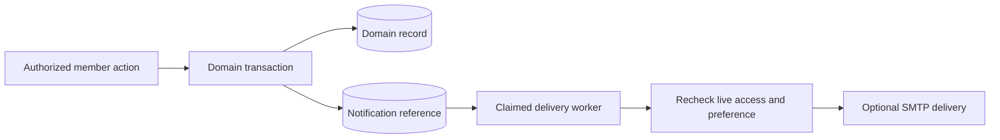

# Data ownership and lifecycle

The [schema reference](reference/SCHEMA.md) lists every mapped field, enum,
relationship, foreign-key action, index and table constraint. This guide explains
what the groups represent and which records are authoritative.

## Database foundations

SQLAlchemy models use the shared `Base` metadata in `app/db/base.py`. UUID primary
keys normally use UUIDv7; association records often use a composite account/content
key. A UUID is an identifier, not permission to read the record. Timestamp mixins
supply database-created timestamps. Services normalize timezone-naive values read
from SQLite to UTC where needed; display and local scheduling have separate rules.

`app/models/__init__.py` imports the full registry for migration metadata. New
models must be registered there and receive a migration. Runtime model declarations
alone do not upgrade an installed database. Development/tests support SQLite;
production supports PostgreSQL with dialect-specific upserts/locking where needed.

Uniqueness is part of correctness: messages, memberships, Helpful votes, likes,
applications, invitation attribution, webhook receipts and offline receipts use
stored keys to tolerate retries or constrain duplicate state. Preserve those keys
when changing an endpoint. Check constraints reject invalid lifecycle/channel data.

Foreign-key `CASCADE`, `SET NULL` and `RESTRICT` have different retention meanings.
Deleting a parent may remove dependent records, retain a historical reference with
a null actor, or be blocked. Inspect the declaration and owning deletion service
before changing the action. Filesystem cleanup is a separate durable workflow.

## Record groups

| Group | Main records | Ownership and meaning |
| --- | --- | --- |
| Identity | `User` | Phone/password/account lifecycle and private contact data. `is_staff` is separate from account type. `auth_version` invalidates older sessions. |
| Recovery and disk cleanup | `AccountToken`, `FileDeletion` | Single-use hashed purpose/email/version credentials; cleanup tasks survive account removal. |
| Social sign-in | `SocialIdentity`, `SocialAuthAttempt`, `SocialEnrollment` | Provider/subject linkage, browser-bound handshake and temporary claims awaiting local registration. |
| Professional profile | `NurseProfile`, `FieldVisibility`, `CredentialClaim` | Owner record with explicit field sharing and discoverability; professional declarations do not prove regulator confirmation. |
| Document review | `VerificationCase`, `EvidenceDocument`, `EvidenceAccess` | Staff document/name decision, private file retention and audited evidence access. Approval supports document reviewed, not regulator-source confirmation. |
| Employers | `EmployerOrganization`, `EmployerMembership`, `EmployerReviewEvent` | Organization and individual authorization with separate staff decisions. |
| Public community | `CommunityTopic`, `CommunityPost`, `CommunityReply`, `CommunityMedia` | Host-owned community and published/moderatable content; Reel social content shares posts/replies. |
| Private participation | `CommunityMembership`, `DiscussionFollow`, `DiscussionReplyRead` | Joined community choice, conversation subscription and rendered-reply receipts. |
| Useful answers | `HelpfulReply`, `CommunityAnswer`, `PostLike` | Member feedback, question author's chosen answer and shared desired-state likes. They establish different facts. |
| Network and moderation | `Follow`, `Connection`, `ContentReport` | Directional subscription, mutual messaging connection and private moderation/report history. |
| Peer support | `MentorOffer`, `Mentorship`, `MentorReport` | Explicit public offer, private bounded-capacity request and report-specific staff review. |
| Community activity | `ActivitySeries`, `ActivityOccurrence`, `ActivityAttendance` | Recurring local schedule, generated public discussion and private intent to participate. |
| Next steps and welcomes | `MemberJourney`, `CommunityIntroduction` | Private goal/reminder preference and saved public introduction with host welcome state. |
| Personal sharing | `ReferralInvitation`, `ReferralVisit`, `MemberReferral` | Expiring destination invitation, approximate browser visits and valid new-account attribution; owner sees aggregate outcomes. |
| Weekly digest | `DigestPreference`, `WeeklyDigest` | Verified-email opt-in and one claimed receipt per local week; no stored mail-content snapshot. |
| Conversations | `DirectMessage`, `MessageAttachment`, `MessageUploadUsage` | Private accepted-connection content, staged/sent file ownership and durable quota usage. |
| Notifications | `NotificationPreference`, `Notification` | Per-category channels, private record references and optional email outbox leases/retries. |
| Reels | `Reel`, `ReelSave` | Leased video processing extension to a post and private bookmarks. |
| Opportunities | `Job`, `JobApplication`, `SavedOpportunity`, `OpportunityPreference` | Eligible public native/external listing, consented native submission and private matching/bookmark choices. |
| Recruitment sources | `RecruitmentOrganization`, `RecruitmentSource`, `DiscoverySchedule`, `DiscoveryTask`, `SourceEvent` | Candidate evidence, explicit collection authority/scope and leased observations/decision history. |
| Vacancy provenance | `VacancySnapshot`, `VacancyRecord`, `VacancyEvent` | Original collection evidence, normalized reviewable facts and processing history separate from the public Job. |
| Educator/content | `EducatorProfile`, `EducatorReview`, `LearningCourse`, `LearningModule`, `LearningLesson`, `QuizQuestion` | Teaching permission, author-owned curriculum and server-side answer keys. |
| Learner progress | `LearningEnrollment`, `LessonProgress`, `QuizAttempt` | Account-owned enrollment and actual recorded lesson/quiz progress, not accreditation. |
| Live learning | `LearningSession`, `SessionRegistration`, `SessionMessage`, `SessionModeration`, `LearningAttendance`, `LearningRecording`, `LearningWebhookReceipt` | Scheduled room state, atomically allocated seats, authorized chat/moderation and verified provider attendance/recording events. |
| Events | `CommunityEvent`, `EventAttendance` | Staff-published event and private RSVP intent. |
| Offline server state | `OfflineOperation`, `OfflineUpload` | Account/payload-bound operation receipt and resumable staging bound to session scope/expiry. |
| Usage/admin/operations | `UserDailyActivity`, `StaffRoleEvent`, `UserTour`, `WorkerHeartbeat` | Private day-level usage, role audit, account tour progress and worker role/instance progress. |

## Similar states that must stay distinct

A professional profile can be active while its fields remain private. Joining a
public community does not publish a private member roster. A person follow is
directional; an accepted connection is mutual and enables messaging. Ending peer
support leaves that separate connection under the members' control.

Helpful feedback, a selected answer, a like, an event RSVP, activity participation,
a lecture seat, lesson completion and verified live attendance describe different
actions. None is a professional license or accredited qualification. Do not derive
one from another merely because their UI appears on the same page.

A discovered recruitment page is not an approved collector; an approved collector
can yield no vacancies. A normalized vacancy may be held for missing facts or
duplicate review. A stored `Job.status` is not the whole public eligibility check:
services also consider source authority and dates. Use the public predicate.

Account welcome, guided tour, next-step reminder and browser installation reminder
have separate owners. [Dashboard onboarding](DASHBOARD_ONBOARDING.md) documents the
specific `MemberJourney.dismissed_at` rule.

## Durable state and side effects

Notifications store references rather than duplicating private message bodies or
application details. Current record eligibility is checked again on listing and
delivery. The caller owns the `emit` transaction; it cannot be treated as a mail
send. SMTP cannot share an atomic database commit, so retries can duplicate mail
after an acceptance/crash boundary.

Reel processing, discovery tasks and email receipts use expiring claims. A token
fences a previous worker from saving a late result after a replacement has claimed
the work. Provider webhook receipts deduplicate authenticated event IDs inside the
same domain transaction. Browser local flags are not substitutes for either kind
of receipt.

## Files and browser storage

| Location | Contents / access | Owning implementation |
| --- | --- | --- |
| Configured avatar directory | Account photo; route applies current visibility | `accounts.py`, `account_routes.py` |
| Configured community media directory | Uploaded community/Reel source and playback files; public route checks publication state | `core/community_storage.py`, `community.py`, `reel_worker.py` |
| Configured private message media directory | Validated/scanned opaque conversation files, served only after authorization | `core/message_storage.py`, `message_attachments.py` |
| Configured evidence directory | Quarantined/released private review documents with access audit and retention | `core/storage.py`, `verification.py`, `evidence.py` |
| Offline staging under the media volume | Expiring resumable chunks, not public playback | `offline_uploads.py` |
| Configured backup directory | Private consistent SQLite copies and referenced files/manifests | `backups.py` |
| Configured private recording bucket | LiveKit egress objects, accessed through short-lived authorized signatures | `education_live.py` |
| Browser IndexedDB | Consented encrypted account-scoped snapshots, drafts, keys and operation state | `offline-store.js` and offline scripts |
| Browser local/session storage | Display/install choices and bounded offline coordination signals; no plaintext private-content cache | `display.js`, `mobile-app.js`, `offline-store.js` |
| Service-worker cache / native bundle | Public application assets and neutral shell; no authenticated page snapshot | `service-worker.js`, mobile bundle scripts |

Files are written outside database atomicity. Services reconcile failures and
retain cleanup work where necessary. An object existing on disk does not prove it
is released, public or currently readable. Never put private upload roots beneath
`app/static/` or overlap message/evidence/community storage roots.

Backup/restore and migration instructions are in [maintenance](MAINTENANCE.md),
[hosting](HOSTING.md) and [migration rules](../migrations/README.md). Inspect runtime
configuration privately; never paste real tokens, database URLs or member data
into documentation or verification artifacts.
