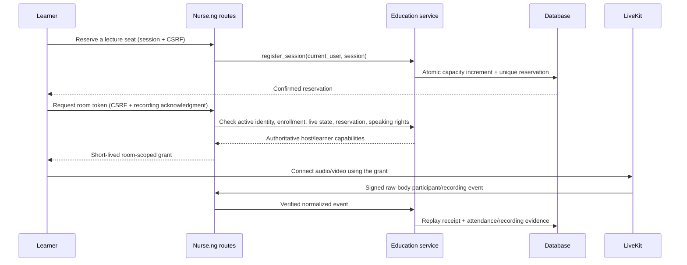

# Educator courses and live classrooms

Nurse.ng's learning domain supports approved educators, structured courses,
learner enrollment/progress, server-scored knowledge checks, scheduled live
lectures/discussions, classroom moderation, private recordings and lecture
notifications. This guide explains the implementation and how to extend it.
For the wider codebase, begin with [CODE_GUIDE.md](CODE_GUIDE.md).

## Main entry points

| Member or staff journey | Route |
| --- | --- |
| Discover courses and lectures | `/learning/live` |
| Return to enrolled learning | `/learning/live/mine` |
| Apply to teach and manage owned content | `/learning/live/studio` |
| Review teaching applications | `/staff/educators` |
| Course outline and enrollment | `/learning/live/courses/{course_id}` |
| Read a lesson or answer a knowledge check | `/learning/live/lessons/{lesson_id}` |
| Lecture schedule, reservation and recording access | `/learning/live/sessions/{session_id}` |
| Prejoin setup and live classroom | `/learning/live/sessions/{session_id}/room` |
| Signed LiveKit callbacks | `/learning/live/webhooks/livekit` |

The existing `/learning` resource page and recurring community activities remain
available. Teaching is a separate permission on an ordinary account; educators
do not receive administrator access.

## Code map

| File | Responsibility |
| --- | --- |
| `app/models/education.py` | Teaching applications/reviews, courses/modules/lessons, enrollment/progress/quiz attempts, sessions/reservations, discussion/moderation, attendance, recordings and webhook receipts |
| `app/services/education.py` | Authoritative ownership, publication, seat allocation, scoring, lifecycle and signed-event application |
| `app/services/education_live.py` | LiveKit tokens/RPCs, raw webhook authentication, event normalization and private S3 playback signing |
| `app/services/education_notifications.py` | Idempotent upcoming-lecture reminders and schedule/lifecycle notices |
| `app/web/education_routes.py` | Discovery, learner pages, educator authoring and review forms |
| `app/web/education_common.py` | Shared presentation queries, current progress and bounded classroom JSON input |
| `app/web/education_classroom_routes.py` | Live grants, host controls, recordings and provider callback orchestration |
| `app/web/education_errors.py` | Safe domain/provider errors in HTML or JSON |
| `app/templates/education/` | Accessible member/staff page components and native forms |
| `app/static/js/education.js` | Form enhancements, confirmations and presentation behavior |
| `app/static/js/education-room.js` | Prejoin media, LiveKit event lifecycle, transmitted camera processing, tracks, reconnect, discussion and controls |
| `app/static/css/education.css` | Scoped learning/classroom layouts and responsive theme styles |

## Boundaries and data flow



The browser connects media directly to LiveKit. Render does not carry the
lecture's audio/video streams or hold recordings on its temporary filesystem.
The application remains responsible for identity, membership, hosting approval,
questions, moderation decisions and the learning record.

## Permissions

An educator application starts pending. Staff decisions are retained in review
history. Approval grants teaching permission only. Changes to the public teaching
identity require another review. Pausing an educator prevents new teaching grants
and public discovery. Approval removal and approved teaching-identity changes
close the educator's active provider classrooms before committing the new
approval state. Invalid submissions do not close classrooms.

Course creation requires approved teaching permission. Course and session edits
require ownership or active staff moderation. A learner can see a published
outline but opens lessons only after enrolling. Session-associated courses also
require current enrollment before reservation and room entry.

In lecture mode learners initially listen and subscribe. They may raise their
hand; the host can grant or revoke speaking. Discussion reservations begin with
speaking permission. Both modes use the persisted permission when issuing a new
token, so reconnecting cannot undo a host's revocation. Hosts may share their
screen; an ordinary learner grant does not include host administration rights.

Camera/microphone publication stays under the participant's control. A host may
mute a track or allow speaking but cannot force the participant's camera on.
Removal persists an excluded reservation status and disconnects the provider
participant. A removed learner cannot obtain a fresh room token.

## Course and assessment lifecycle

Courses begin as drafts. Publishing requires usable modules/lessons and complete
questions for quiz lessons. Material edits that leave an unusable curriculum
return it to draft. Modules/lessons are explicitly ordered and positions are
unique inside their parent. Authoring retains the parent owner rather than
accepting a submitted ownership field.

Enrollment retries reuse the same membership. Written/resource/video lesson
completion is a learner acknowledgment. Quiz completion requires server scoring
against private answer keys and the lesson's passing threshold. Course progress
is derived from the current outline, and 100% means every current lesson is complete.

Assessment revisions are explicit integers. A revised question, option, passing
threshold or relevant lesson content invalidates the affected completion. Quiz
forms include the revision they displayed. Stale forms are rejected instead of
grading old option positions against a new question. Request IDs make retries
reuse the original attempt; a changed revision requires a new attempt. Answer-key
hashes are not exposed as revision tokens because small quizzes would allow
offline guessing of their answer keys.

Completion is a learning record. The implementation does not issue professional
registration, clinical competence verification or accredited continuing-education credits.

## Scheduled session lifecycle

Sessions progress from draft to scheduled, then live, then ended. Draft/scheduled
sessions may be cancelled; a live cancellation first closes the remote room.
Cancelled sessions do not become live again. Starting is permitted within fifteen
minutes of the planned start and before the planned end.

The stable room name is `nurse-learning-{session_uuid}`. All server calls derive
it from the persisted session identifier. Browser input cannot choose another
provider room. PostgreSQL row locks serialize host starts, recording requests
and token/moderation decisions. Operations acquire account, educator-profile,
and session locks in that order, so approval changes can close rooms and withdraw
permission while concurrent starts and token requests wait. A conditional update
protects seat capacity on both supported databases, and a unique reservation
prevents duplicate allocation. SQLite uses its writer lock for classroom
mutations and reports temporary contention as a retryable service error.

Provider calls and database transactions have distinct failure boundaries. A
remote call must succeed before a corresponding live/recording result is committed.
A database failure after remote acceptance may require a retry; the stable room
name and signed provider callbacks help reconcile the resulting state. External
calls have bounded timeouts and do not block the ASGI event loop.

Revoking an educator with several live rooms can fail after some remote rooms
have already closed. The approval/session database changes roll back on that
failure; retrying safely deletes any already-absent provider rooms and completes
the transition. A media failure is reported rather than claiming that all rooms
closed. Room deletion disconnects current participants, but LiveKit bearer
tokens already issued remain cryptographically valid until their expiry (300
seconds by default, configurable from 60 to 600). Nurse.ng refuses fresh tokens
after the approval change; provider deletion is not token revocation.

## Camera and audio quality

The classroom offers an explicit private setup preview, camera/microphone
selection, 1080p/720p/data-saving choices and optional gentle light correction.
HD capture uses ideal constraints and negotiates the resolution the device can
provide. The interface reports the achieved resolution rather than assuming an
HD label proves HD capture.

LiveKit adaptive streaming, dynacast and simulcast match transmitted/received
video to network and viewing needs. Microphone constraints request echo
cancellation, noise suppression and automatic audio gain where supported.
The local camera preview is mirrored; remote video is not mirrored.

Light correction uses a real video-track processor. Its canvas output is the
published track, so the improvement is not a cosmetic CSS preview filter.
Neutral is the default. The processor and original camera track are released
when preview/publication stops. The controller handles permission denial,
unavailable devices, reconnection and audio-only participation. Hardware and
room illumination still determine the detail/noise available to the software.
Stopping preview, selecting audio-only mode, leaving the page, or cancelling
room entry also invalidates pending capture/join work. A late camera stream is
released rather than activating after the participant has left.

## Signed attendance and private recordings

An RSVP or successful token request does not establish attendance. Participant
join/leave records come from authenticated provider events. LiveKit's JWT binds
the SHA-256 digest of the exact request bytes. Verification precedes JSON
normalization; reserializing JSON before verification would break that binding.
Event IDs and payload hashes support transactional replay handling and reject
conflicting repeats without storing raw provider payloads or credentials.

Recordings require explicit session recording enablement and a visible prejoin
acknowledgment. Only hosts request recording. Provider egress writes to an
operator-controlled private S3-compatible bucket under `learning/{session_uuid}/`.
Accepted recording requests are starting/recording work, not completed files.
Authenticated final events establish completion and validate the private object
key. Playback rechecks current learner access and returns a short-lived signed
GET URL; it never makes the bucket public.

## Deployment configuration

Add these settings to the existing production environment when activating media:

```dotenv
# LiveKit project/server values; keep the API secret server-side.
NURSE_NG_LIVEKIT_URL=wss://your-livekit-host
NURSE_NG_LIVEKIT_API_KEY=
NURSE_NG_LIVEKIT_API_SECRET=
```

Configure LiveKit's webhook destination as:

```text
https://your-public-nurse-host/learning/live/webhooks/livekit
```

Private recording settings are described in `app/core/config.py` and the
environment examples, [.env.example](../.env.example) and
[deploy/production.env.example](../deploy/production.env.example). Keep the
LiveKit API secret and recording keys in the hosting environment. Configure the
recording bucket, access key and secret together. Set the region; AWS S3 needs
no endpoint override, while another S3-compatible provider needs its HTTPS
origin. The default uses path-style object URLs. Use a private bucket with a
scoped storage key and appropriate retention, rather than Render's ephemeral
filesystem. The provider module signs playback access and sanitizes its failures.

Camera, microphone and screen sharing require browser permission and a secure
page (HTTPS in production; localhost is allowed for development). A denied
camera does not prevent audio-only participation. Run
`python -m app.cli check-config` to validate deployment settings without contacting the database
or issuing a classroom grant.

When media credentials are absent, course learning and scheduling remain usable
and classroom entry honestly reports unavailable service activation. Capability
presence is not a health or delivery guarantee. Provider service, recording
storage, participant limits and production availability need their own setup.
Render Free can serve the application, but scheduled teaching/reminders need an
always-running service/worker for dependable operation.

Migrate with `venv/bin/alembic upgrade head` after backing up and rehearsing on an
isolated copy. The new revision is `e6480k1e9038`. Downgrade refuses to delete
existing education records. No sample courses or educator accounts are inserted
into an actual installation by the migration.

## Tests and changes

Focused domain and HTTP tests cover educator ownership, privacy, draft exposure,
seat allocation/retries, revision-aware grading, moderation, signed events and
recording access. Reminder queries stream all due sessions in bounded fetch
batches, so simultaneous lectures beyond the first batch still receive notices.
Tests cover this volume case, retries, withdrawal and rescheduling. Provider tests cover browser/server grants, restricted origins,
signature/body binding and private storage signing. The Chrome media runner
exercises actual capture, transmitted lighting processing and track cleanup with
a synthetic camera; it does not establish the quality of a physical device.

```sh
venv/bin/python -m pytest tests/test_education.py tests/test_education_routes.py tests/test_education_live.py
venv/bin/python -m pytest tests/test_education_notifications.py
venv/bin/python tests/browser/education_media.py
venv/bin/python tests/browser/education_journeys.py
```

The browser journey uses migrated temporary SQLite data and synthetic educator,
learner and staff accounts. It exercises actual form submissions and responsive
pages; `--keep-preview --port 14400` retains that isolated app for review.
Neither browser runner inserts demo accounts into the actual app database.

For PostgreSQL, set `NURSE_NG_TEST_POSTGRES_URL` to a loopback database named
`nurse_ng_learning_test`, then run:

```sh
venv/bin/python tests/hosting/education_journey.py --output /tmp/education-postgres.json
```

The PostgreSQL runner refuses other hosts/database names and query overrides.
It creates and cleans only randomly named test schemas inside that database,
checks fresh and historical migrations against the model metadata, exercises
capacity races, and proves token/start actions wait behind educator revocation.
Its media calls are mocked; it verifies real database locking rather than an
external provider connection.

Changing the provider requires preserving the domain contract, token role
semantics, raw signature verification, normalized event envelope and private
recording-key rules. Changing the curriculum requires updating revision and
completion semantics together. Changing the room DOM requires updating the
documented controller hooks and browser checks together.
